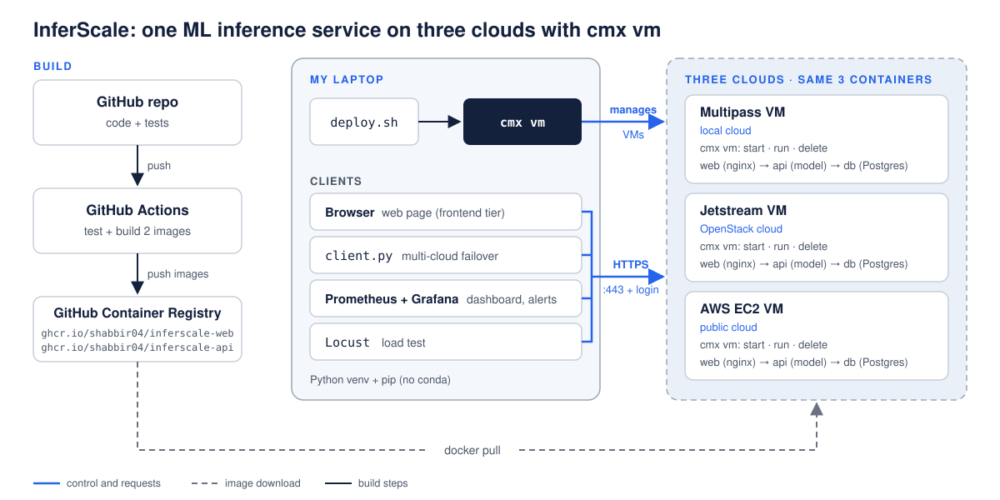
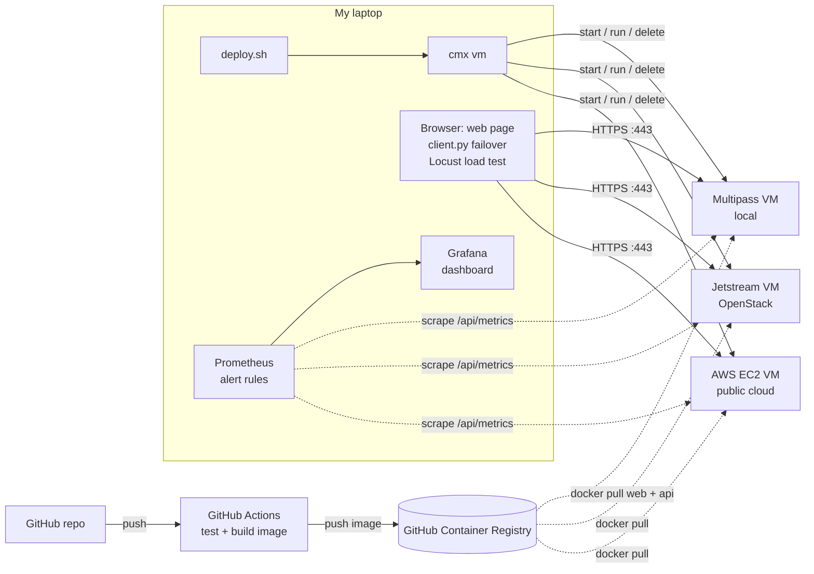
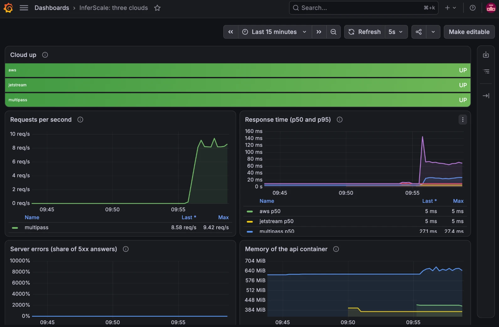
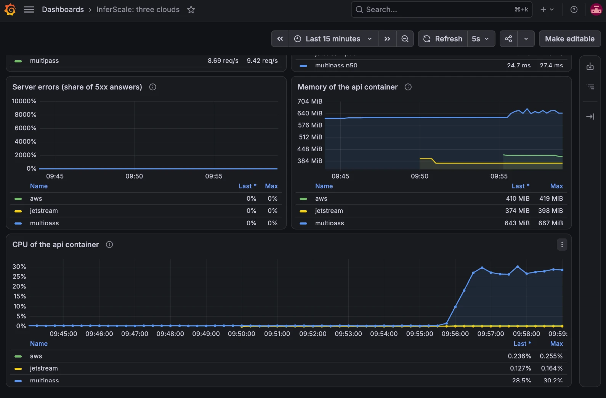
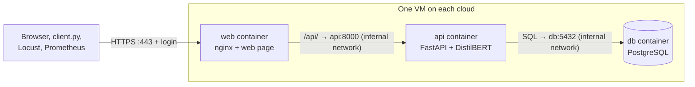

# InferScale: One ML Inference Service on Three Clouds with cmx vm

|                  |                                                                  |
| ---------------- | ---------------------------------------------------------------- |
| **Course:**      | COMP 488 – Cloud Computing, DevOps, and AI                       |
| **Team Members** | - *Khaja Shabbir Ahmed* – Cloud / DevOps Engineer (solo project) |
| **Contact**      | <kahmed5@luc.edu>                                                |
| **Instructor**   | Gregor von Laszewski                                             |
| **Repository**   | https://github.com/cloudmesh-ai-luc/shabbir04                    |
| **Presentation** | [InferScale-Presentation.pdf](InferScale-Presentation.pdf) (12 slides) |
| **Date**         | *Sep. 22, 2026*                                                  |

---

## 1. Executive Summary

**Problem.** The same AI service often has to run on more than one cloud, but every cloud has its own
way to create VMs, give them a public IP and clean them up. That makes deployments hard to repeat and
clouds hard to compare fairly.

**What InferScale does.** InferScale is a small three-tier machine-learning service: a web frontend (nginx and
a small HTML/JavaScript page), a backend that serves a sentiment-analysis model (DistilBERT) through a
FastAPI REST API, and a PostgreSQL database that keeps each user's history of analyses. Each tier is its own
Docker container, and the same three containers run on three clouds: **Multipass** on my laptop (local), **Jetstream** (OpenStack) and **AWS EC2** (public
cloud). All VMs are created, reached and deleted with one tool, **`cmx vm`** from the class project
[cloudmesh-ai-vm](https://github.com/cloudmesh-ai/cloudmesh-ai-vm), which I also contribute to. One
deploy script runs the same steps on every cloud, and a load test measures how each cloud performs.
On top of plain predictions, InferScale has three features: an **AI review filter**, **live monitoring
with alerts** of all three clouds (Prometheus and Grafana), and **multi-cloud failover**. The web page and
the API are protected with accounts and passwords over HTTPS.

**Result.** A repeatable, automated workflow and a side-by-side comparison of deployment time, response
time and cost on the three clouds. Where `cmx vm` falls short for this workflow, I fix it in small pull
requests (for example the `cmx vm ip` command).

---

## 2. Cloud Computing, DevOps, and AI

| Area | How InferScale addresses it |
| ---- | --------------------------- |
| **Cloud Computing** | Runs the same service as VMs (IaaS) on three different kinds of cloud: a local hypervisor, an OpenStack research cloud and a public cloud. Each VM runs a three-tier application: a public web frontend, a private model backend and a private database. Uses each cloud's networking (local IP, floating IP, public IP), security groups and a cloud organization's region policy (AWS), and compares cost. `cmx vm` hides the differences behind one command line. **Feature: multi-cloud failover.** When one cloud is down, requests go to the next cloud. |
| **DevOps** | GitHub flow (branches, pull requests, issues), automated tests and Docker builds with GitHub Actions, a container registry, one deploy script for all clouds, a smoke test after every deployment, and clean-up so nothing keeps running. **Feature: live monitoring with alerts.** Every VM reports its requests, errors and response time at `/metrics`. Prometheus collects them from all three clouds, Grafana shows them on one dashboard, and an alert fires when a cloud stops answering or has too many errors. |
| **AI** | The workload is an AI model: DistilBERT sentiment analysis served for inference on CPU. The project measures how fast that model answers on each cloud. **Feature: review filter.** The model returns only the reviews with a chosen label (for example, negative) that it is confident about. |

---

## 3. Requirements, Objectives & Success Criteria

The requirements say what InferScale must do (functional) and how well it must do it (non-functional).
Each one is checked by a test or a measurement (sections 5.9 and 9).

### 3.1 Functional Requirements

| ID | The system must… |
| -- | ---------------- |
| FR-1 | Classify one review (`POST /api/predict`): return the label and score (`UNCERTAIN` below an optional `min_score`), and save the result in the database |
| FR-2 | Filter a list of reviews (`POST /api/filter`) by label and minimum score |
| FR-3 | Show the signed-in account its recent analyses (`GET /api/history`) |
| FR-4 | Offer a web page to analyze, filter and see the history, behind a login |
| FR-5 | Require a login for every page and API call, `/api/health` included; allow `/api/metrics` only for `owner` and `prometheus` |
| FR-6 | Deploy and remove the service on each cloud with `make deploy` and `make destroy` (`deploy.sh`), exporting the database before a VM is deleted |
| FR-7 | Send a request to the next cloud when one cloud fails (`client.py`) |
| FR-8 | Monitor all three clouds with alerts, and load-test each cloud |

### 3.2 Non-Functional Requirements

| ID | Quality | Requirement |
| -- | ------- | ----------- |
| NFR-1 | Performance | Server-side p95 under 1 second for one review, with 10 users |
| NFR-2 | Reliability | At least 99 % of requests succeed, also during failover |
| NFR-3 | Security | HTTPS and login; the backend and the database have no public port; no secrets in Git |
| NFR-4 | Deployability | Under 15 minutes per cloud, with the same script on every cloud |
| NFR-5 | Resources and cost | Runs on a 1 vCPU, 2 GB VM; $0 out of pocket and under $1 per AWS session |
| NFR-6 | Data durability | The history survives container restarts (Docker volume) and is exported before a VM is deleted |

### 3.3 Objectives & Success Criteria

| # | Objective | Success criterion |
| - | --------- | ----------------- |
| 1 | Package the three tiers as containers | `/health` and `/predict` pass the tests; the web page shows a prediction; CI builds the web and api images (the database uses the official PostgreSQL image) |
| 2 | Run the service on three clouds using `cmx vm` for all VM management | `/predict` answers on Multipass, Jetstream and AWS |
| 3 | Automate the deployment | `make deploy` and `make start` go from no VM to a working service on any of the three clouds |
| 4 | Measure and compare the clouds | A results table with deploy time, latency (p50/p95), success rate and cost per cloud |
| 5 | Improve `cmx vm` where the project needs it | Small, reviewed pull requests to cloudmesh-ai-vm |
| 6 | AI review filter | `/filter` returns only the reviews with the chosen label and a score at or above the threshold |
| 7 | Live monitoring with alerts | One Grafana dashboard shows requests, errors and response time for all three clouds, updated every 5 seconds; an alert fires when a cloud stops answering |
| 8 | Multi-cloud failover | With one cloud's VM deleted during a test run, requests still succeed through the other clouds |

---

## 4. Scope

| In scope | Out of scope |
| -------- | ------------ |
| Three tiers: web frontend (nginx + HTML/JavaScript), backend (FastAPI + DistilBERT) and a PostgreSQL database, each in its own container | Training or fine-tuning models |
| Three clouds: Multipass, Jetstream, AWS EC2 | Kubernetes and autoscaling (dropped to keep the project simple) |
| Deploy script built on `cmx vm` | GPUs |
| CI with GitHub Actions | High availability and 24/7 monitoring (monitoring runs only during my sessions) |
| Load test and comparison of the three clouds | Other public clouds (Azure, GCP) |
| Small fixes to `cmx vm` | A load balancer in front of the clouds (failover is done in the client) |
| Three features: review filter, live monitoring with alerts, multi-cloud failover | Sending alerts by email or chat (alerts are shown in Prometheus and Grafana) |
| Login with fixed accounts over HTTPS | Sign-up pages and self-service accounts; frontend frameworks such as React; a Let's Encrypt certificate (it needs a domain name) |
| A history of analyses in a PostgreSQL database on each VM | Copying the database between clouds (each cloud keeps its own history); managed databases such as AWS RDS |

---

## 5. Technical Approach

### 5.1 Architecture





| Component | Technology | Notes |
| --------- | ---------- | ----- |
| Web frontend (`web` container) | nginx, HTML + JavaScript | Serves the web page over HTTPS, checks the login and forwards `/api/` to the backend; the only public port (443) |
| Backend API (`api` container) | Python, FastAPI, Hugging Face Transformers | Endpoints `GET /health`, `POST /predict`, `POST /filter`, `GET /history`, `GET /metrics`; port 8000 on the internal Docker network only |
| Database (`db` container) | PostgreSQL 16 (official image) | Stores the history of analyses; port 5432 on the internal Docker network only; data in a Docker volume |
| Monitoring and alerts | Prometheus, Grafana (Docker in a local Multipass VM, `make monitor`) | Prometheus collects `/metrics` from all three clouds every 5 seconds and checks the alert rules; Grafana shows one dashboard |
| Failover client | `client.py` | Sends each request to AWS, then Jetstream, then Multipass, until one answers |
| Containers | Docker, Docker Compose (`compose.yaml`), GitHub Container Registry | Images `ghcr.io/cloudmesh-ai-luc/inferscale-web` and `ghcr.io/cloudmesh-ai-luc/inferscale-api` (the workflow's token can push only under the repository owner); the database uses `postgres:16.16-alpine` |
| VM management | `cmx vm` (cloudmesh-ai-vm, `dev3` branch) | The only tool used to create, reach and delete VMs |
| Deployment | `make deploy` / `start` / `demo` / `stop` / `destroy` (`deploy.sh`) | Runs the same `cmx vm` steps on each cloud |
| Load test | Locust | Runs from my laptop against each cloud |

**Data tier.** Each VM runs its own PostgreSQL database in a third container. It stores every analysis from
`/api/predict` (time, account, text, label and score), so each user can see their history. The database
has no public port: only `api` reaches it, on the internal Docker network. Its data lives in a Docker volume,
so it survives container restarts, and `make destroy` exports it (`pg_dump`) to `results/<cloud>/` before the
VM is deleted. Each cloud keeps its own history; copying data between clouds is out of scope, so failover
still works without any data sync. Metrics, the Grafana dashboard and the load-test results stay on my
laptop and in this repository.

### 5.2 Three Clouds and cmx vm

**Why these three.** Multipass is free and fast for development. Jetstream is the class OpenStack
research cloud. AWS is the most widely used public cloud, and new accounts get Free plan credits.

**Why Jetstream and not Chameleon (decided Nov 26).** I first planned Chameleon KVM@TACC. Twice
(Nov 19 and Nov 26) it had no free capacity: the lease started, but the VM failed with "No valid host
was found". Chameleon also needs a lease for every VM, and a failed start leaves the lease running.
Jetstream needs no leases, has had capacity every time I used it, and `cmx` supports it well, so the
project uses Jetstream. `make deploy CLOUD=chameleon` still works if Chameleon has capacity again.

| | Local | OpenStack | Public |
| - | ----- | --------- | ------ |
| **Cloud** | Multipass on my Mac | Jetstream | AWS EC2 |
| **`cmx vm` provider** | `multipass` | `jetstream` | `aws` |
| **VM size** | 2 vCPU, 4 GB, 20 GB disk (set in `~/.config/cloudmesh/clouds.yaml`) | `m3.tiny` (1 vCPU, 3 GB) | `t4g.small` (2 vCPU, 2 GB, ARM Graviton, free-tier eligible; 8 GB disk) |
| **OS image** | Ubuntu 24.04 (ARM, like my Mac) | Featured-Ubuntu24 (x86) | Ubuntu 24.04 ARM (`ami-09c4af6de8b9844f6`) |
| **How the service is reached** | The VM's local IP | Floating IP, assigned by `cmx vm start` | The instance's public IP (no paid Elastic IP: `cmx vm start --noip`) |
| **Port 443 (HTTPS, frontend tier)** | Open by default | Security group `inferscale-shabbir04-https`: port 443 from my IP only, made with `cmx vm security-group` | Security group `inferscale`: ports 22 and 443 from my IP only |
| **Special step** | None | `cmx vm delete` keeps the floating IP, so `make destroy` releases it | Region `us-east-2` only (my account's organization policy blocks EC2 in the other regions); delete the instance after every session |
| **Status** | `make deploy`, `start`, `demo`, `stop` and `destroy` tested (Nov 26) | `make deploy`, `start`, `demo` and `destroy` tested (Nov 26) | `make deploy`, `start`, `demo` and `destroy` tested (Nov 26) |

**One command per step, the same on every cloud.** From my laptop, in the `cmx` virtual environment:

```bash
make deploy  CLOUD=jetstream   # cmx vm start, Docker, git clone, certificate, password hashes, make image
make start   CLOUD=jetstream   # make up on the VM, then wait until https://<ip>/api/health answers
make demo    CLOUD=jetstream   # example requests as the client account
make stop    CLOUD=jetstream   # make down on the VM; the VM and the data stay
make destroy CLOUD=jetstream   # logs and a pg_dump to results/jetstream/, then cmx vm delete
```

`deploy.sh` does the work, and it reaches the clouds only through `cmx vm`:

```bash
export OS_CLOUD=jetstream                          # cmx uses this cloud; clouds.yaml is not changed
cmx vm start inferscale-shabbir04                  # AWS: --noip; Chameleon: --duration 3h
cmx vm info inferscale-shabbir04 --json            # the VM's IP
cmx vm security-group create inferscale-shabbir04-https          # Jetstream: port 443 from my IP only
cmx vm security-group rule add inferscale-shabbir04-https --protocol tcp --port 443 --cidr <my-ip>/32
cmx vm security-group add inferscale-shabbir04 inferscale-shabbir04-https
cmx vm run inferscale-shabbir04 "..."             # apt docker.io, git clone, make certs, make image, make up
cmx vm delete inferscale-shabbir04
```

On the VM it installs Docker from Ubuntu's own packages (no script piped into `sh`), clones this
repository, makes the certificate (`make certs`; the private key never leaves the VM) and copies the
two password-hash files that `make passwords` made on my laptop. The VM's certificate comes back to my
laptop over SSH (`cmx vm run ... cat`), so every later call checks it without trusting the network.
`cmx vm run` stops a command after 30 seconds, so the long steps (installing Docker, building the
images) run in the background on the VM, and `deploy.sh` checks every 15 seconds until they end.
Passwords are passed to `curl` on standard input, never on the command line.

One file, `compose.yaml`, describes the three containers, so the same `make up` runs on every cloud.
Only the `web` container publishes a port (`443:8443`). The `api` and `db` containers have no public
port; `web` reaches `api` (`api:8000`) and `api` reaches `db` (`db:5432`) by name on the private network
that Compose creates. `api` starts only when the database's health check (`pg_isready`) passes. The
database data lives in the Docker volume `pgdata`. The database password is random, created on the VM
in `db.env` (`umask 077`, ignored by Git) and never leaves it. The two login files hold only password hashes; the
passwords themselves stay in `~/.config/inferscale/` on my laptop (section 5.6).

**Clean-up with `make destroy`.** One command undoes a deployment: it saves the container logs and a
database export (`pg_dump`) to `results/<cloud>/` (ignored by Git, because the nginx logs contain my IP
address), runs `cmx vm delete`, releases the floating IP on Jetstream, forgets the VM's IP and
certificate, and tells the monitoring to stop watching the cloud, so Prometheus does not raise a false
`CloudDown` alert and the failover client does not try a deleted VM.

**Multi-cloud failover.** `tools/client.py` sends each request to the first cloud that answers, in the
order AWS, Jetstream, Multipass. It has no configuration of its own: it reads the deployed clouds from
`~/.config/inferscale/clouds/<cloud>.env` (written by `make deploy`), checks each cloud's own certificate
and logs in as `client`, using only Python's standard library. After a cloud fails, the client skips it
for 30 seconds (a simple circuit breaker), so a dead cloud does not add a 3-second timeout to every request:

```python
def predict(text, clouds, login):
    now = time.monotonic()
    for cloud in clouds:                      # AWS, then Jetstream, then Multipass
        if cloud.down_until > now:
            continue                          # failed recently: skip it for now
        request = urllib.request.Request(f"{cloud.url}/predict", data=json.dumps({"text": text}).encode(),
                                         headers={"Content-Type": "application/json", "Authorization": login})
        try:
            with urllib.request.urlopen(request, timeout=3, context=cloud.tls) as response:
                return cloud.name, json.load(response)
        except OSError:                       # no answer, a TLS error, or an HTTP error such as 502
            cloud.down_until = now + 30
    raise RuntimeError("all clouds are down")
```

The demo: `python tools/client.py --demo 200` sends 200 predictions while `make stop CLOUD=aws` takes AWS
down halfway, and the requests keep working through Jetstream.

### 5.3 DevOps Pipeline

| Stage | Tool | What it does |
| ----- | ---- | ------------ |
| Source | GitHub | One branch per change, pull requests, issues |
| Test | pytest, pip-audit, gitleaks, hadolint, Trivy (GitHub Actions, `.github/workflows/ci.yml`) | Unit tests on Python 3.15.2, a dependency audit, a secret scan of the whole history, Dockerfile checks and an image scan on every push and pull request (section 5.9) |
| Build | Docker (GitHub Actions) | Builds both images (`inferscale-web`, `inferscale-api`) on every push and pull request, so a broken Dockerfile is found before a deployment; the VMs still build their own images with `make image` |
| Deploy | `make deploy` + `cmx vm` | Creates the VM and starts the three containers on the chosen cloud |
| Verify | `curl /api/health`, Locust | Checks the service through the frontend tier, then measures latency |
| Monitor | Prometheus + Grafana | Shows live requests, errors and response time for all three clouds, and raises an alert when a cloud is down or has too many errors |
| Clean up | `make destroy` + `cmx vm delete` | Saves logs and the database, then removes the VM (and on Jetstream its floating IP) after each session |

**CI (Nov 26).** Three jobs run in parallel on every push and pull request: **tests** (pytest and
pip-audit on Python 3.15.2), **secrets** (gitleaks over every commit) and **docker** (hadolint on both
Dockerfiles, then both images are built and scanned with Trivy). The workflow can only read the
repository (`permissions: contents: read`), and every action is pinned to a commit, not a tag, so a
changed tag cannot change what runs. Before the first run I ran the same checks by hand, and they found
real problems, which I fixed:

| Check | Found | Fix |
| ----- | ----- | --- |
| Trivy, `web` image | 26 fixable HIGH/CRITICAL (nginx, musl, libxml2, libxslt) in `nginx-unprivileged:1.30.6-alpine` | Mainline `1.31.7-alpine` (nginx recommends mainline) plus `apk upgrade`: 0 left |
| Trivy, `api` image | 7 HIGH: copies of urllib3, msgpack and setuptools inside pip, wheel inside setuptools, and Debian's libzstd1 | Newer setuptools, Debian security updates, and pip removed from the finished image (the service never installs packages): 0 left |
| Trivy, `db` image | 33 HIGH/CRITICAL in the newest official `postgres:16.16-alpine` (Alpine's libxml2, the `gosu` helper) | Only fixable upstream, so CI reports them without failing; I update the tag when a newer image appears |
| gitleaks | 1 finding: a `curl -u client:"$(cat …password)"` example in an old version of this document | A false positive (the command reads the password from a file); recorded in `.gitleaksignore` with the reason |
| hadolint | Health checks in shell form, a user name instead of a number | JSON form and `USER 10001` |
| pip-audit | Nothing | — |

After the fixes, the login and security tests of section 5.3 gave the same results with the new images.

The Python environment is a `venv` with `pip`, not conda, which keeps the VMs and containers clean.

**Small, traceable images.** The `api` image starts from `python:3.15.2-slim`, installs the CPU-only build
of PyTorch and downloads the model when the image is built, then runs as the normal user `app`. The
image is 2.2 GB on disk: PyTorch 860 MB, the other libraries 300 MB, the model 270 MB and the Python
base 160 MB (PyTorch with GPU libraries alone would be several GB). The container runs with
`HF_HUB_OFFLINE=1`, so it never needs Hugging Face at start-up. A `.dockerignore` allow-list sends only
`pyproject.toml`, `VERSION`, `README.md` and `src/` into the build, so `.git`, `.venv`, tests and any key
or `db.env` file can never end up in the image. Each image is tagged with the version from `VERSION`
(for example `inferscale-api:0.1.0`), the Git commit (for example `inferscale-api:3f9c2ab`) and `latest`.
Every result can be traced to the code that produced it, and a bad release can be rolled back to the last
good version on all three clouds. The packages are public, so the VMs pull them without a login.

**First test on Multipass (Nov 26).** `make image` and `make up` in a `cmx vm` VM (2 vCPU, 4 GB): the
`api` container was healthy 28 seconds after `make up`, a prediction took about 22 ms on average over
20 requests, and the containers used about 430 MB (`api`) and 25 MB (`db`) of memory, so a 2 GB cloud
VM is enough. The history survived `make down` and `make up`, and ports 8000 and 5432 could not be
reached from outside the VM.

**First test on AWS (Nov 26).** The same steps on a `t4g.small` VM made with `cmx vm start --noip`:
`make image` took 171 seconds, `make up` was healthy after 23 seconds and a prediction took about 57 ms.
The 8 GB disk was 90% full after the build (77% after `docker builder prune`), so it fits, but only just.
The VM was deleted afterwards, with no disk or IP left behind.

**First full deployment on Jetstream (Nov 26).** `make deploy CLOUD=jetstream` made the VM (`m3.tiny`)
with a floating IP, opened port 443 for my IP, installed Docker and built the images in about 3 minutes;
`make start` had the service answering over HTTPS 43 seconds later, and `make demo` returned the
expected labels, the filter result and the history, with `401` without a login. From my Mac over the
internet, a prediction took about 180 ms on average (20 requests, each with a new HTTPS connection).
Only ports 22 (SSH, from the project's `remotelogin` group) and 443 were open. Two `cmx` problems came
up: `cmx vm run` passes the public key file to `ssh -i` (#131), so the private key must be loaded with
`ssh-add ~/.ssh/id_ed25519`, and `cmx vm info --json` names the IP differently on each cloud
(`FloatingIP` on Jetstream, `ip` on Multipass), so `deploy.sh` accepts both. `make destroy` then saved
the container logs and a database export (22 predictions) to `results/jetstream/`, deleted the VM and
released the floating IP; afterwards the project had no server and no floating IP left.

**The same commands on Multipass (Nov 26).** `make deploy CLOUD=multipass` took 3 minutes, `make start`
answered after 32 seconds and `make demo` gave the same results. `make stop` left no container running;
`make start` answered again after 16 seconds with the history kept, and `make destroy` saved the logs and
the database and deleted the VM.

**The same commands on AWS (Nov 26).** `make deploy CLOUD=aws` took 4 minutes, `make start` answered
after 37 seconds and `make demo` gave the same results. With all three containers running, the 8 GB disk
was 78% full (1.6 GB free, because `deploy.sh` deletes Docker's build cache after the build), the
containers used about 430 MB of the 2 GB memory (`api` 386 MB, `db` 28 MB, `web` 12 MB), only ports 22
and 443 were open (for my IP only), and a prediction from my Mac took about 200 ms. `make destroy` left
no instance, disk or Elastic IP, and the month's AWS cost stayed at $0.00 (Free plan).

| Cloud | `make deploy` | `make start` until HTTPS answers | Prediction from my Mac |
| ----- | ------------- | -------------------------------- | ---------------------- |
| Multipass (local) | 3 min | 32 s | — (local network) |
| Jetstream | 3 min | 43 s | about 180 ms |
| AWS (`us-east-2`) | 4 min | 37 s | about 200 ms |

These are single first runs, not yet the measurements of section 9.

**Web tier test on Multipass (Nov 26).** With all three containers (`web` image 90 MB):

| Check | Result |
| ----- | ------ |
| No login, wrong password | `401` on the page and on every `/api/` path |
| Certificate | Made on the VM for its IP; `curl` without the saved certificate rejects the server |
| TLS | TLS 1.1 refused; TLS 1.3 with HTTP/2 |
| Open ports from outside | Only 443 (80, 8000, 5432, 8080 and 8081 closed) |
| `demo` sends `X-User: owner` | Ignored: the review is saved under `demo`, and `owner` does not see it |
| `/api/metrics` | `owner` and `prometheus` get `200`; `demo` and `client` get `401`; `prometheus` gets `401` everywhere else |
| Rate limit (300 requests, 30 at a time) | 135 answered, 165 refused with `429` |
| Container users | `web` runs as `nginx`, `api` as `app` |
| Prediction through nginx, HTTPS and login | About 26 ms (22 ms without nginx) |

**Live monitoring with alerts.** `make monitor` creates a local Multipass VM (`inferscale-monitor`) with
`cmx` and runs Prometheus 3.16 and Grafana 13.3 in Docker there (`monitoring/compose.yaml`); my Mac itself
has no Docker. Prometheus collects `/api/metrics` through the frontend tier of every deployed cloud every
5 seconds, over HTTPS with the `prometheus` account, checking each cloud's own certificate. `make start`
and `make destroy` run `monitor.sh targets`, which writes one small file per deployed cloud and reloads
Prometheus, so the clouds it watches always match the deployments:

```yaml
# monitoring/prometheus/scrape/jetstream.yml (written by monitor.sh; prometheus.yml reads scrape/*.yml)
scrape_configs:
  - job_name: jetstream
    scheme: https
    metrics_path: /api/metrics                # nginx forwards it to the backend
    basic_auth:
      username: prometheus
      password_file: /etc/prometheus-secrets/prometheus.password   # from ~/.config/inferscale, not in Git
    tls_config:
      ca_file: /etc/prometheus-secrets/jetstream.pem               # this cloud's own certificate
    static_configs:
      - targets: ["<jetstream-ip>:443"]
        labels: {cloud: jetstream}
```

```yaml
# monitoring/prometheus/alerts.yml (shortened)
- alert: CloudDown          # /api/metrics did not answer for 1 minute
  expr: up == 0
  for: 1m
- alert: HighErrorRate      # more than 5 % of the API's answers are 5xx for 2 minutes
  expr: sum by (cloud) (rate(http_requests_total{status="5xx"}[2m]))
        / sum by (cloud) (rate(http_requests_total[2m])) > 0.05
  for: 2m
```

The Grafana dashboard ("InferScale: three clouds", `monitoring/grafana/dashboards/inferscale.json`) has one
line per cloud in six panels: which clouds are up, requests per second, response time p50 and p95,
the share of server errors, and the api container's memory and CPU. Grafana needs a login (the admin
password is made on my laptop and kept in `~/.config/inferscale/`), sign-up and anonymous access are off,
and usage reporting to Grafana Labs is off. Grafana (port 3000) and Prometheus (port 9090) can only be
reached from my Mac, because Multipass's network is private to it.

**Monitoring test (Nov 27).** With InferScale on Multipass, `make start` added the cloud to Prometheus
on its own, and the target was `up`. All six dashboard queries returned data after a few requests from
`tools/client.py`. `make stop` took the service down: `CloudDown` fired about a minute later, and after
`make start` it cleared at once. Grafana answered `401` without a login.

The dashboard on Nov 27 with all three clouds up, during the first load test on Multipass (about 9
requests per second, 27 ms median on the server):





### 5.4 The Three Tiers and the Web Page

InferScale has three tiers. Each runs in its own container on the same VM:

| | Frontend tier | Backend tier | Data tier |
| - | ------------- | ------------ | --------- |
| **Container** | `web`: nginx + one HTML/JavaScript page | `api`: FastAPI + DistilBERT | `db`: PostgreSQL 16 |
| **Image** | `ghcr.io/shabbir04/inferscale-web` | `ghcr.io/shabbir04/inferscale-api` | `postgres:16-alpine` (official) |
| **Job** | Shows the web page, checks the login and forwards `/api/...` to the backend | Runs the model, answers the API and saves each analysis | Stores the history of analyses |
| **Port** | 443 (HTTPS, login needed), the only public port | 8000, internal Docker network only | 5432, internal Docker network only |



The page has three parts: type one review and press **Analyze** to see its label and score, paste several
reviews and press **Filter** to see only the confident ones with the chosen label, or open **My history**
to see the last 20 reviews this account analyzed. The browser asks for a user name and password first. nginx serves the page over HTTPS, checks the login, limits the
request rate and passes API calls to the backend:

```nginx
# web/nginx.conf (shortened); nginx's unprivileged image runs as the normal user nginx
limit_req_zone $binary_remote_addr zone=perip:10m rate=50r/s;
limit_req_status 429;
server_tokens off;                                        # hide the nginx version
resolver 127.0.0.11 valid=10s;                            # Docker's DNS: finds api again after a restart

server {
    listen 8443 ssl;                                      # published as port 443
    http2 on;
    ssl_certificate     /etc/nginx/secrets/tls.crt;
    ssl_certificate_key /etc/nginx/secrets/tls.key;
    ssl_protocols       TLSv1.2 TLSv1.3;
    auth_basic           "InferScale";
    auth_basic_user_file /etc/nginx/secrets/htpasswd;    # bcrypt hashes, no plain passwords
    limit_req zone=perip burst=100 nodelay;              # too many requests -> 429
    add_header Content-Security-Policy "default-src 'self'; frame-ancestors 'none'" always;
    # (also X-Content-Type-Options, X-Frame-Options and Referrer-Policy)

    set $api http://api:8000;
    location / { root /usr/share/nginx/html; try_files $uri /index.html; }   # the web page
    location ^~ /api/metrics {                                                # only owner and prometheus
        auth_basic_user_file /etc/nginx/secrets/metrics.htpasswd;
        rewrite ^/api/(.*)$ /$1 break;
        proxy_pass $api;
    }
    location /api/ {                                                          # forward to the backend tier
        rewrite ^/api/(.*)$ /$1 break;
        proxy_pass $api;
        proxy_set_header X-User $remote_user;   # the signed-in account; replaces any X-User the client sends
    }
}
```

The page calls the backend only through nginx, so the browser never talks to the model container directly:

```javascript
async function analyze() {
  const text = document.getElementById("text").value;
  const r = await fetch("/api/predict", {method: "POST", headers: {"Content-Type": "application/json"},
                                         body: JSON.stringify({text})});
  const {label, score} = await r.json();
  document.getElementById("result").textContent = `${label} (${score.toFixed(2)})`;
}
```

The page and the API come from the same address, so no CORS setup is needed, and the browser sends the
login with every call.

### 5.5 AI / Model Serving (Backend Tier)

The model is `distilbert/distilbert-base-uncased-finetuned-sst-2-english`. It is small enough to run on a
CPU and fit in a 2 GB VM. The core of the service:

```python
# src/inferscale/app.py
import asyncio
import os
from contextlib import asynccontextmanager
from functools import lru_cache
from typing import Literal

import psycopg
from fastapi import Depends, FastAPI, Header, HTTPException, Query
from pydantic import BaseModel, Field
from prometheus_fastapi_instrumentator import Instrumentator
from transformers import pipeline

MODEL = "distilbert/distilbert-base-uncased-finetuned-sst-2-english"
# the password comes from db.env, made on the VM by `make up`, never from Git
DB_URL = f"postgresql://inferscale:{os.environ.get('POSTGRES_PASSWORD', '')}@db:5432/inferscale"
SCHEMA = """CREATE TABLE IF NOT EXISTS predictions (
    id SERIAL PRIMARY KEY, created_at TIMESTAMPTZ NOT NULL DEFAULT now(),
    account TEXT NOT NULL, text TEXT NOT NULL, label TEXT NOT NULL, score REAL NOT NULL)"""

@lru_cache
def get_classifier():
    return pipeline("sentiment-analysis", model=MODEL)   # loaded once, then reused

def get_db():
    try:
        conn = psycopg.connect(DB_URL, connect_timeout=3)
    except psycopg.OperationalError:
        raise HTTPException(503, "database not available")
    with conn:                                           # commits when the request ends
        yield conn

@asynccontextmanager
async def lifespan(app):
    for _ in range(30):                                  # wait up to 30 s for the db container
        try:
            with psycopg.connect(DB_URL) as conn:
                conn.execute(SCHEMA)
            break
        except psycopg.OperationalError:
            await asyncio.sleep(1)
    get_classifier()                                     # load the model at start-up
    yield

app = FastAPI(lifespan=lifespan)
Instrumentator().instrument(app).expose(app)             # adds GET /metrics

class Review(BaseModel):
    text: str = Field(min_length=1, max_length=5000)
    min_score: float | None = Field(None, ge=0, le=1)   # optional: below it the label is UNCERTAIN

class Reviews(BaseModel):
    texts: list[str] = Field(min_length=1, max_length=100)
    label: Literal["POSITIVE", "NEGATIVE"] = "NEGATIVE"
    min_score: float = Field(0.9, ge=0, le=1)

@app.get("/health")
def health():
    return {"status": "ok"}

@app.post("/predict")
def predict(item: Review, user: str = Header("unknown", alias="X-User"),
            classifier=Depends(get_classifier), db=Depends(get_db)):
    result = classifier(item.text, truncation=True)[0]  # e.g. {"label": "POSITIVE", "score": 0.99}
    if item.min_score is not None and result["score"] < item.min_score:
        result = {"label": "UNCERTAIN", "score": result["score"]}      # not confident enough
    db.execute("INSERT INTO predictions (account, text, label, score) VALUES (%s, %s, %s, %s)",
               (user, item.text, result["label"], result["score"]))   # parameters, not joined text
    return result

@app.post("/filter")
def filter_reviews(item: Reviews, classifier=Depends(get_classifier)):
    # only the confident reviews with the chosen label, e.g. the confident negative ones
    results = classifier(item.texts, truncation=True)
    return [{"text": t, **r} for t, r in zip(item.texts, results)
            if r["label"] == item.label and r["score"] >= item.min_score]

@app.get("/history")
def history(limit: int = Query(20, ge=1, le=100), user: str = Header("unknown", alias="X-User"),
            db=Depends(get_db)):
    rows = db.execute("SELECT created_at, text, label, score FROM predictions "
                      "WHERE account = %s ORDER BY id DESC LIMIT %s", (user, limit)).fetchall()
    return [{"time": created.isoformat(), "text": text, "label": label, "score": score}
            for created, text, label, score in rows]
```

The Pydantic models check every request, so bad input gets a clear `422` error instead of crashing the
service. `truncation=True` cuts texts that are longer than the model's limit of 512 tokens. With the
optional `min_score`, `/predict` answers `UNCERTAIN` when the model is not confident enough. The model and
the database are handed to the endpoints with `Depends`, so the tests can swap in fakes (section 5.9).

`/metrics` comes from the `prometheus-fastapi-instrumentator` library. It counts every request with its
status code and response time, in the format Prometheus reads.

### 5.6 Security

**Accounts and passwords.** The web page and the API need a login. nginx checks it with HTTP Basic
authentication, and only over HTTPS, so a password is never sent in clear text. The accounts are a fixed
list that I create, so no sign-up page is needed (the database stores analyses, not accounts):

| Account | Used by | Can use |
| ------- | ------- | ------- |
| `owner` | Me | Web page, API, metrics |
| `demo` | The professor and the class during a demo; the password is changed after every demo | Web page, API |
| `client` | `client.py` and Locust | Web page, API |
| `prometheus` | Prometheus on my laptop | Metrics only |

- **Passwords** are 24 random characters (`openssl rand -base64 24`), made by `make passwords`, and live
  only on my laptop in `~/.config/inferscale/` (files 600, folder 700, outside Git). The VM receives only
  bcrypt hashes (`htpasswd -B`, built into macOS), so the passwords themselves are never stored on a
  cloud. The bcrypt cost is 5, not higher: nginx checks the hash on every request, and a 24-character
  random password cannot be guessed anyway, so a slow hash would only slow down the service.
- **Browser protections.** nginx sends a Content-Security-Policy (only scripts from the site itself),
  forbids framing (`X-Frame-Options: DENY`), turns off MIME sniffing and hides its version. The page
  writes results with `textContent`, never `innerHTML`, so the text of a review cannot inject HTML.
  Only TLS 1.2 and 1.3 are accepted.
- **HTTPS.** `make certs` creates a self-signed certificate for the VM's IP on the VM. `deploy.sh` copies
  it to my laptop over SSH and checks it on every later call, so a fake server is rejected. Browsers show a
  warning once, because no authority signed the certificate; a free Let's Encrypt certificate would need
  a domain name, which this project does not have.
- **Rate limit.** nginx allows 50 requests per second from one address (bursts up to 100) and answers
  `429` above that. This slows down password guessing and floods; the load test stays below the limit.
- **Network.** Only port 443 is open, and only during testing. The backend has no public port: it is
  reached only through nginx on the internal Docker network. Every VM is deleted after each session.
- **Containers run as normal users**, not root: `web` uses nginx's unprivileged image (port 8443 inside
  the container) and `api` runs as the user `app`.
- **No secrets in Git.** Cloud credentials and passwords stay in `~/.config/`. `.gitignore` blocks `*.env`,
  `secrets/`, `*.pem`, `*.key`, `*.password`, `htpasswd`, `id_*` and `clouds.yaml`, and CI runs a secret scan (gitleaks) and a
  dependency check (pip-audit) on every push.
- **Database.** PostgreSQL has no public port and only `api` can reach it. Its password is random,
  created on the VM (`db.env`, readable only by the VM's user, ignored by Git) and never leaves it. The API uses
  parameterized SQL (values are passed separately, never joined into the query), which prevents SQL
  injection. nginx tells the API which account is signed in (`X-User`), so each user sees only their own
  history.
- **VM login** only with SSH keys, never passwords.
- Prometheus and Grafana run only on my laptop, and the test data is public example text with no
  personal data.

### 5.7 Error Handling and Readiness Checks

| Level | What can go wrong | How it is handled |
| ----- | ----------------- | ----------------- |
| API | Missing or wrong input, a text that is too long | Pydantic returns a clear `422` error; `truncation=True` handles long texts |
| Login | A wrong password or too many requests | nginx answers `401` or `429` before the request reaches the model |
| Database | The database is still starting or goes down | At start-up `api` waits up to 30 seconds for it; later, a request that needs it gets `503`, and the `db` container restarts by itself |
| Containers | A container crashes | Both run with `--restart unless-stopped`; `web` is restarted after `api` so nginx finds the new address |
| `deploy.sh` | A `cmx vm` step or a step on the VM fails (for example "No valid host" when a cloud is full) | `set -euo pipefail` stops the script at the first error; a failed step on the VM shows the end of its log |
| Smoke test | The model needs 20–60 seconds to load | `curl -f` retries `/api/health` every 10 seconds for up to 5 minutes |
| Client | A cloud is down or returns an HTTP error | `client.py` fails over to the next cloud (`raise_for_status()`) |
| Operation | A cloud stops answering or many requests fail | The `CloudDown` and `HighErrorRate` alerts fire |

**Before the first full deployment** I check the parts that everything else depends on:

- [ ] `cmx vm run` works on each cloud (for example `cmx vm run inferscale "uname -a"`). So far only
      `start`, `list`, `ip assign` and `delete` are tested.
- [ ] A small test image goes the whole way: GitHub Actions → GitHub Container Registry → `docker pull` on a
      VM. The workflow's built-in token can only push under the repository owner (`cloudmesh-ai-luc`), so
      the images go there or are pushed with a personal token stored as a GitHub secret.
- [ ] The VM disks are big enough for the 2.2 GB image. Multipass is set to 20 GB (done); AWS gives
      8 GB by default, so its disk has to be raised to 20 GB.
- [ ] Prometheus in Docker on my laptop can reach the Multipass VM's local IP.
- [x] The VM has a unique name in the shared Jetstream project (`inferscale-shabbir04`), so a delete can
      never pick another student's VM.

### 5.8 API Reference

All calls go to `https://<vm-ip>`, where nginx checks the login and forwards `/api/...` to the backend.

| Method and path | Login | Request | Response |
| --------------- | ----- | ------- | -------- |
| `GET /` | Any account | – | The web page |
| `GET /api/health` | None | – | `{"status": "ok"}` |
| `POST /api/predict` | Any account | `{"text": "…"}` (1–5000 characters), optional `"min_score": 0.8` | `{"label": "POSITIVE", "score": 0.998}`, or `UNCERTAIN` below `min_score`; the result is saved |
| `POST /api/filter` | Any account | `{"texts": ["…"], "label": "NEGATIVE", "min_score": 0.9}` (1–100 texts) | The matching reviews with their label and score |
| `GET /api/history?limit=20` | Any account | – | This account's last analyses: time, text, label, score |
| `GET /api/metrics` | `owner`, `prometheus` | – | Prometheus metrics |

**Errors:** `401` no or wrong login, `422` invalid input, `429` too many requests, `502` backend not
reachable, `503` database not available.

```bash
curl --cacert ~/.config/inferscale/certs/aws.pem -u client https://<aws-ip>/api/predict \
     -H "Content-Type: application/json" -d '{"text": "Great movie, I loved it!"}'
# {"label":"POSITIVE","score":0.9998}
```

### 5.9 Testing

| Test | Tool | What it checks | When |
| ---- | ---- | -------------- | ---- |
| Unit | pytest + FastAPI `TestClient` (Python 3.15.2) | Each endpoint's normal answer and its `422` errors; the results of `/filter` and `/history` | Every push and pull request (CI) |
| Security scan | pip-audit, gitleaks, hadolint, Trivy | No dependency with a known vulnerability; no secret in any commit; clean Dockerfiles; no fixable HIGH or CRITICAL vulnerability in the `api` and `web` images | Every push and pull request (CI) |
| Image build | `docker build` in CI | Both Dockerfiles still build | Every push and pull request (CI) |
| Container | `curl` against the three containers on a VM | The login is required and works; `/api/metrics` only for `owner` and `prometheus`; a client cannot fake `X-User`; the rate limit answers `429`; only port 443 is open | By hand on Multipass so far (section 5.3); in CI later |
| Smoke | `make start` | `/api/health` answers over HTTPS after a deployment | Every deployment |
| Load, failover, alert | Locust, `client.py`, stopping a container | The targets in section 9 | Measurement runs |

The unit tests replace the model and the database with small fakes (FastAPI's `dependency_overrides`), so
they run in seconds without downloading the model or starting PostgreSQL.

---

## 6. Project Plan & Timeline

| Phase | Tasks | When | Status |
| ----- | ----- | ---- | ------ |
| Topic | Title, first summary | Sep 23 – Oct 1 | Done |
| `cmx vm` on two clouds | VM lifecycle on Multipass and Chameleon, including the `cmx vm ip` command | Sep 29 – Oct 14 | Done |
| Simpler design | Three clouds + `cmx vm` instead of Kubernetes | Oct 14 | Done |
| Third cloud | AWS account and credentials, first `cmx vm` VM on AWS | Oct 15 – Oct 22 | Done (Nov 26) |
| Service | Backend (FastAPI + model, `/filter`, `/history`, `/metrics`), PostgreSQL, frontend (web page + nginx, HTTPS, login), Dockerfiles, tests | Oct 15 – Oct 29 | Done (Nov 26) |
| CI | GitHub Actions: tests, dependency audit, secret scan, Dockerfile checks, image build and scan | Oct 29 – Nov 5 | Done (Nov 26); pushing images to a registry is still open |
| Deploy script | `make deploy` / `start` / `demo` / `stop` / `destroy` for all three clouds | Nov 5 – Nov 12 | Done (Nov 26) |
| Monitoring + failover | Prometheus + Grafana (dashboard, alert rules), `tools/client.py` | Nov 12 – Nov 19 | Done (Nov 27) |
| Measurements | Load tests and the failover test on the three clouds, results table | Nov 19 – Dec 3 | Done (Nov 27) |
| Final | Report and presentation | Dec 3 – Dec 10 | Planned |

---

## 7. Resources & Budget

| Resource | Use | Cost |
| -------- | --- | ---- |
| Multipass on my Mac | Development and the local cloud | $0 |
| Jetstream, `m3.tiny` | Short sessions, deleted afterwards | Class allocation (service units), no money |
| AWS EC2 `t4g.small` (us-east-2) | Short sessions, deleted afterwards | Free-tier eligible; otherwise about $0.017 per hour, covered by AWS Free plan credits |
| GitHub Actions and Container Registry | CI and image storage | $0 within the free limits |
| Prometheus and Grafana (Docker on my Mac) | Monitoring and alerts | $0 (open source) |
| PostgreSQL (official image, on each VM) | History of analyses | $0 (open source) |
| **Total** | | **$0 out of pocket** |

---

## 8. Risk Management

| Risk | Likelihood | Impact | Mitigation |
| ---- | ---------- | ------ | ---------- |
| A cloud has no free capacity ("No valid host was found", as on Chameleon twice) | Medium | Delay | Jetstream instead of Chameleon; retry at another time; keep sessions short |
| A floating IP stays reserved after `cmx vm delete` on Jetstream | High | Uses the shared IP pool | `make destroy` releases it; fix it in `cmx` with a pull request |
| An AWS instance is left running | Low | Cost | Delete after every session; set a billing alert |
| The model and the database need more memory than the VM has | Medium | Service crashes | Use 2 GB VMs; keep PostgreSQL small; add swap or use a smaller model |
| Credentials leak | Low | High | Keep them only in `~/.config/`, never in Git |
| The failover demo needs two or three clouds running at once | Medium | More cost and allocation | Keep the demo under 30 minutes and delete everything right after |
| A password leaks (for example the demo password) | Low | Someone else uses the service | Change it in `~/.config/inferscale/` and redeploy; change the demo password after every demo |
| The browser warns about the self-signed certificate | High | The demo looks broken | Explain it once and accept the certificate before the demo |
| The history is lost when a VM is deleted | Medium | Lost data | `make destroy` exports the database (`pg_dump`) first |

---

## 9. Evaluation & Success Metrics

| Metric | How it is measured | Target |
| ------ | ------------------ | ------ |
| Deploy time (`cmx vm start` → first good `/predict`) | Timer in `deploy.sh` | Under 15 minutes on each cloud |
| Model start-up (cold start) | Timer in `deploy.sh`: `docker compose up` → first healthy `/api/health` | Reported per cloud |
| Latency p50 / p95 | Locust, 60 s, 10 users (end to end), and Prometheus (time on the server only) | Reported per cloud |
| Success rate | Locust | At least 99 % |
| Cost per session | Provider pricing and allocation used | Under $1 per AWS session |
| Same script on all three clouds | Run `deploy.sh` with each cloud | Works without changes to the steps |
| Review filter accuracy | `/filter` on 20 reviews I label by hand | At least 18 of 20 correct |
| Live monitoring | Grafana dashboard during a load test | All three clouds shown, updated every 5 seconds |
| Alerts | Take one cloud down (`make stop`) during the failover test | The `CloudDown` alert fires within 2 minutes |
| Failover | 200 requests through `tools/client.py`, AWS taken down halfway (`make stop CLOUD=aws`) | At least 99 % succeed |
| Security | Calls without a password, with a wrong password, and to `/api/metrics` with the `client` account | All rejected with `401`, `/api/health` included |
| History | Analyze 5 reviews, restart all three containers, then open the history | All 5 analyses are still listed |

Each load test runs three times per cloud. The results table reports the median of the three runs, the
image tag (Git commit) and the VM's CPU. The server-side time shows how much of the latency is the
network between my laptop and the cloud, which keeps the comparison fair.

### Results (Nov 27)

All three clouds ran at the same time, with the images from commit `d7687d7` (main after the CI pull
request). `make load CLOUD=<cloud> DURATION=60s` ran three times per cloud, one cloud after the other,
from my Mac on the same network. Locust measures end to end (my Mac → HTTPS → nginx → API → model →
PostgreSQL and back); Prometheus measures the time inside the api container for the same minute.

| Cloud (VM, CPU) | Requests per 60 s | Failed | Requests/s | p50 | p95 | p99 | Server p50 / p95 |
| --------------- | ----------------- | ------ | ---------- | --- | --- | --- | ---------------- |
| Multipass (2 vCPU of my Mac's Apple M chip) | 558 | 0 | 9.4 | 31 ms | 73 ms | 90 ms | 25 / 67 ms |
| Jetstream (`m3.tiny`, 1 x86 vCPU) | 512 | 0 | 8.7 | 99 ms | 210 ms | 270 ms | 53 / 211 ms |
| AWS (`t4g.small`, 2 ARM Graviton vCPU) | 498 | 0 | 8.4 | 140 ms | 290 ms | 410 ms | 97 / 244 ms |

Medians of three runs; over all nine runs, 4,706 requests and none failed (100 % success, target 99 %).

| Deployment | `make deploy` | `make start` until HTTPS answers | Cost of the session |
| ---------- | ------------- | -------------------------------- | ------------------- |
| Multipass | 2–3 min | 32–33 s | $0 |
| Jetstream | 3–8 min (creating the VM took longer the second time) | 43 s | Class allocation (`m3.tiny`, 1 service unit per hour) |
| AWS | 4 min | 37 s | $0.00 (free-tier `t4g.small`, Free plan) |

What the numbers show:

- **The network adds about 45 ms** to the median for both remote clouds (my Mac to Jetstream in Indiana
  or AWS in Ohio), and about 6 ms for the local VM.
- **The CPU decides the server time for the AI model.** AWS's Graviton needs 97 ms per request on the
  server, Jetstream's single x86 vCPU 53 ms, my Mac's Apple M chip 25 ms. PyTorch runs faster on these
  x86 and Apple CPUs than on Graviton, and `t4g` instances are burstable (made for short bursts, not
  steady load). The cheapest instance is not automatically the best one for inference; the CPU type has
  to be tested with the real workload.
- **The slowest requests come from the server**, not the network: on Jetstream and AWS the server p95 is
  almost the whole end-to-end p95, because with one or two vCPUs, requests wait for each other.
- All three clouds stayed far below nginx's rate limit and the 99 % success target at about 9 requests
  per second; a higher load would show where each VM saturates.

**Failover and alert test.** `python tools/client.py --demo 200` sent 200 predictions while all three
clouds were running; after about 20 seconds, `make stop CLOUD=aws` took AWS down. AWS answered requests
1 to 49, and from request 50 on Jetstream answered: **200 of 200 requests succeeded** (target 99 %), and
none was lost during the switch. The `CloudDown` alert for AWS fired 51 seconds after `make stop` had
finished (target: within 2 minutes), and after `make start CLOUD=aws` (36 s) it cleared again.

---

## 10. Deliverables

| Deliverable | Format |
| ----------- | ------ |
| Backend (FastAPI + model + database access), frontend (web page + nginx) and the database schema, their Dockerfiles, and the tests in `tests/` | Code in this repository |
| GitHub Actions workflow | `.github/workflows/` |
| `make deploy` / `start` / `demo` / `stop` / `destroy` (`deploy.sh`), built on `cmx vm` | Makefile and script in this repository |
| Review filter (`/filter`) and `/metrics` | Part of the inference service |
| Prometheus and Grafana setup (`make monitor`: `monitor.sh`, `monitoring/compose.yaml`, `prometheus.yml`, `alerts.yml`, the Grafana dashboard) | Files in this repository, plus dashboard screenshots |
| `tools/client.py` (multi-cloud failover) and `tools/loadtest.py` (`make load`, Locust) | Scripts in this repository |
| Results table and chart for the three clouds | Markdown in this repository |
| Contributions to `cmx vm` | Pull requests to cloudmesh-ai-vm |
| Presentation | In class |

---

## 11. Issues

- **`cmx` gaps on AWS** (found Nov 26): `cmx vm key` and `cmx vm security-group` call libcloud methods
  that the EC2 driver does not have, so I made the key pair and the security group once with libcloud;
  `cmx vm list` shows `None` for AWS VMs; `cmx vm run` stops after 30 seconds; and the disk size cannot be
  set, so every VM gets 8 GB. I report these to `cmx` and fix them in small pull requests.
- **Chameleon could not be used** (Nov 19 and 26): KVM@TACC had no free capacity, and on `dev3`
  `cmx vm start` failed for every new VM name (my `cmx` pull request fixes it). The project moved to
  Jetstream (section 5.2).
- **Same-named security groups on Jetstream** (found Nov 27). OpenStack allows several security groups
  with the same name. My first `deploy.sh` created `inferscale-shabbir04-https` on every deployment, so
  the second one had two groups of that name, adding the group to the VM by name failed, and port 443
  stayed closed. `deploy.sh` now creates the group only when it is missing, and it checks from my laptop
  that port 443 really is reachable before it continues (an open port answers at once, a closed
  firewall does not answer at all).
- **Success markers in `cmx vm run` output.** When a command fails, `cmx` repeats the whole command in
  its error message, so a check that searched the output for a word written in the command (such as
  `SSH_OK`) could take a failure for a success. The scripts now write the markers with an empty `''` in
  the middle (`SSH''_OK`): the VM's shell prints `SSH_OK`, but the command text never contains it.
- **Floating IPs on Jetstream.** `cmx vm delete` does not release the floating IP, because
  `release_floating_ip()` reads libcloud's `public_ips`, which openstacksdk servers do not have.
  `make destroy` releases it until `cmx` is fixed.
- **Is 2 GB enough** for DistilBERT, PostgreSQL and Docker together? If not, I add swap or use a smaller model.
- **The VMs are not identical** (`t4g.small` has 2 ARM vCPUs and 2 GB, `m3.tiny` has 1 x86 vCPU and 3 GB), so the results note the
  differences instead of treating them as a perfectly fair comparison.
- **Failover is done in the client.** It is the simplest way. A load balancer in front of the clouds would
  be more realistic, but it needs another VM. The cloud IPs change with every deployment, so the client
  reads them from the files `make deploy` writes, and `make start` and `make destroy` update Prometheus;
  nothing has to be edited by hand.

---

## 12. References

- cloudmesh-ai-vm (`cmx vm`): https://github.com/cloudmesh-ai/cloudmesh-ai-vm
- Multipass: https://canonical.com/multipass
- Jetstream2 documentation: https://docs.jetstream-cloud.org
- Amazon EC2 documentation: https://docs.aws.amazon.com/ec2/
- AWS Free Tier: https://aws.amazon.com/free/
- FastAPI: https://fastapi.tiangolo.com
- nginx: https://nginx.org/en/docs/
- nginx Basic authentication: https://nginx.org/en/docs/http/ngx_http_auth_basic_module.html
- FastAPI testing: https://fastapi.tiangolo.com/tutorial/testing/
- Pydantic: https://docs.pydantic.dev
- PostgreSQL: https://www.postgresql.org/docs/
- psycopg: https://www.psycopg.org/psycopg3/docs/
- DistilBERT SST-2 model: https://huggingface.co/distilbert/distilbert-base-uncased-finetuned-sst-2-english
- Locust: https://locust.io
- Prometheus: https://prometheus.io/docs/
- Grafana: https://grafana.com/docs/grafana/latest/
- prometheus-fastapi-instrumentator: https://github.com/trallnag/prometheus-fastapi-instrumentator
