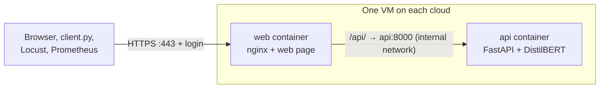

# InferScale: One ML Inference Service on Three Clouds with cmx vm

|                  |                                                                  |
| ---------------- | ---------------------------------------------------------------- |
| **Course:**      | COMP 488 – Cloud Computing, DevOps, and AI                       |
| **Team Members** | - *Khaja Shabbir Ahmed* – Cloud / DevOps Engineer (solo project) |
| **Contact**      | <kahmed5@luc.edu>                                                |
| **Instructor**   | Gregor von Laszewski                                             |
| **Repository**   | https://github.com/cloudmesh-ai-luc/shabbir04                    |
| **Date**         | *Sep. 22, 2026*                                                  |

---

## 1. Executive Summary

**Problem.** The same AI service often has to run on more than one cloud, but every cloud has its own
way to create VMs, give them a public IP and clean them up. That makes deployments hard to repeat and
clouds hard to compare fairly.

**What InferScale does.** InferScale is a small two-tier machine-learning service: a web frontend (nginx and
a small HTML/JavaScript page) in front of a backend that serves a sentiment-analysis model (DistilBERT)
through a FastAPI REST API. Each tier is its own Docker container, and the same two containers run on three
clouds: **Multipass** on my laptop (local), **Chameleon KVM@TACC** (OpenStack) and **AWS EC2** (public
cloud). All VMs are created, reached and deleted with one tool, **`cmx vm`** from the class project
[cloudmesh-ai-vm](https://github.com/cloudmesh-ai/cloudmesh-ai-vm), which I also contribute to. One
deploy script runs the same steps on every cloud, and a load test measures how each cloud performs.
On top of plain predictions, InferScale has three features: an **AI review filter**, **live monitoring
with alerts** of all three clouds (Prometheus and Grafana), and **multi-cloud failover**. The web page and
the API are protected with accounts and passwords over HTTPS.

**Result.** A repeatable, automated workflow and a side-by-side comparison of deployment time, response
time and cost on the three clouds. Where `cmx vm` falls short for this workflow, I fix it in small pull
requests (for example the `cmx vm ip` command).

---

## 2. Cloud Computing, DevOps, and AI

| Area | How InferScale addresses it |
| ---- | --------------------------- |
| **Cloud Computing** | Runs the same service as VMs (IaaS) on three different kinds of cloud: a local hypervisor, an OpenStack research cloud and a public cloud. Each VM runs a two-tier application: a public web frontend in front of a private model backend. Uses each cloud's networking (local IP, floating IP, public IP), security groups, Chameleon leases, and compares cost. `cmx vm` hides the differences behind one command line. **Feature: multi-cloud failover.** When one cloud is down, requests go to the next cloud. |
| **DevOps** | GitHub flow (branches, pull requests, issues), automated tests and Docker builds with GitHub Actions, a container registry, one deploy script for all clouds, a smoke test after every deployment, and clean-up so nothing keeps running. **Feature: live monitoring with alerts.** Every VM reports its requests, errors and response time at `/metrics`. Prometheus collects them from all three clouds, Grafana shows them on one dashboard, and an alert fires when a cloud stops answering or has too many errors. |
| **AI** | The workload is an AI model: DistilBERT sentiment analysis served for inference on CPU. The project measures how fast that model answers on each cloud. **Feature: review filter.** The model returns only the reviews with a chosen label (for example, negative) that it is confident about. |

---

## 3. Requirements, Objectives & Success Criteria

The requirements say what InferScale must do (functional) and how well it must do it (non-functional).
Each one is checked by a test or a measurement (sections 5.9 and 9).

### 3.1 Functional Requirements

| ID | The system must… | Checked by |
| -- | ---------------- | ---------- |
| FR-1 | Classify one review: `POST /api/predict` returns the label (`POSITIVE` or `NEGATIVE`) and a score between 0 and 1 | Unit test |
| FR-2 | Filter a list of reviews: `POST /api/filter` returns only the reviews with the chosen label and a score of at least `min_score` (default 0.9) | Unit test |
| FR-3 | Offer a web page where a signed-in user can analyze one review or filter a list | Container test |
| FR-4 | Require a user name and password for the web page and the API; only the `owner` and `prometheus` accounts may read `/api/metrics` | Security test |
| FR-5 | Answer `GET /api/health` without a login, so deployment and monitoring can check the service | Smoke test |
| FR-6 | Expose requests, errors and response times at `/api/metrics` in Prometheus format | Container test |
| FR-7 | Deploy the whole service on a chosen cloud with `./deploy.sh <cloud>`, using only `cmx vm` for the VM | Deployment on each cloud |
| FR-8 | Remove a deployment with `./destroy.sh <cloud>`: save the container logs, delete the VM, end the Chameleon lease, and remove the cloud from monitoring and failover | Run after every session |
| FR-9 | Send a request to the next cloud when one cloud fails (`client.py`) | Failover test |
| FR-10 | Show all three clouds on one Grafana dashboard and raise the `CloudDown` and `HighErrorRate` alerts | Alert test |
| FR-11 | Measure latency and success rate per cloud with Locust and save the results as CSV files | Load test |

### 3.2 Non-Functional Requirements

| ID | Quality | Requirement | Checked by |
| -- | ------- | ----------- | ---------- |
| NFR-1 | Performance | Server-side p95 response time under 1 second for one review, with 10 users | Prometheus during the load test |
| NFR-2 | Reliability | At least 99 % of requests succeed in the load test and during failover | Locust, `client.py` |
| NFR-3 | Deployability | Under 15 minutes from `cmx vm start` to the first good `/predict`, with the same script on every cloud | Timer in `deploy.sh` |
| NFR-4 | Recoverability | A crashed container restarts by itself; `CloudDown` fires within 2 minutes | Alert test |
| NFR-5 | Security | HTTPS only; every path except `/api/health` needs a login; passwords are long and random and only their hashes reach the VM; the backend has no public port; no secrets in Git | Security tests (section 5.9) |
| NFR-6 | Resource use | Runs on a 1 vCPU, 2 GB VM; the `api` image is under 2 GB | `docker stats`, image size |
| NFR-7 | Cost | $0 out of pocket; under $1 per AWS session | Billing page, allocation used |
| NFR-8 | Reproducibility | The same images on all clouds, tagged with the Git commit; a run can be repeated with `deploy.sh` | The results table lists the image tag |
| NFR-9 | Observability | Metrics every 5 seconds; container logs are saved before a VM is deleted | Grafana, the `results/` folder |
| NFR-10 | Statelessness | Nothing is stored on the VMs, so any VM can be deleted at any time | Design review |

### 3.3 Objectives & Success Criteria

| # | Objective | Success criterion |
| - | --------- | ----------------- |
| 1 | Package the frontend and backend tiers as Docker images | `/health` and `/predict` pass the tests; the web page shows a prediction; CI builds both images |
| 2 | Run the service on three clouds using `cmx vm` for all VM management | `/predict` answers on Multipass, Chameleon and AWS |
| 3 | Automate the deployment | `./deploy.sh <cloud>` goes from no VM to a working service with one command |
| 4 | Measure and compare the clouds | A results table with deploy time, latency (p50/p95), success rate and cost per cloud |
| 5 | Improve `cmx vm` where the project needs it | Small, reviewed pull requests to cloudmesh-ai-vm |
| 6 | AI review filter | `/filter` returns only the reviews with the chosen label and a score at or above the threshold |
| 7 | Live monitoring with alerts | One Grafana dashboard shows requests, errors and response time for all three clouds, updated every 5 seconds; an alert fires when a cloud stops answering |
| 8 | Multi-cloud failover | With one cloud's VM deleted during a test run, requests still succeed through the other clouds |

---

## 4. Scope

| In scope | Out of scope |
| -------- | ------------ |
| Two tiers: web frontend (nginx + HTML/JavaScript) and backend (FastAPI + DistilBERT), each in its own Docker image | Training or fine-tuning models |
| Three clouds: Multipass, Chameleon KVM@TACC, AWS EC2 | Kubernetes and autoscaling (dropped to keep the project simple) |
| Deploy script built on `cmx vm` | GPUs |
| CI with GitHub Actions | High availability and 24/7 monitoring (monitoring runs only during my sessions) |
| Load test and comparison of the three clouds | Other public clouds (Azure, GCP) |
| Small fixes to `cmx vm` | A load balancer in front of the clouds (failover is done in the client) |
| Three features: review filter, live monitoring with alerts, multi-cloud failover | Sending alerts by email or chat (alerts are shown in Prometheus and Grafana) |
| Login with fixed accounts over HTTPS | Sign-up pages and a user database; frontend frameworks such as React; a Let's Encrypt certificate (it needs a domain name) |

---

## 5. Technical Approach

### 5.1 Architecture


| Component | Technology | Notes |
| --------- | ---------- | ----- |
| Web frontend (`web` container) | nginx, HTML + JavaScript | Serves the web page over HTTPS, checks the login and forwards `/api/` to the backend; the only public port (443) |
| Backend API (`api` container) | Python, FastAPI, Hugging Face Transformers | Endpoints `GET /health`, `POST /predict`, `POST /filter`, `GET /metrics`; port 8000 on the internal Docker network only |
| Monitoring and alerts | Prometheus, Grafana (Docker on my laptop) | Prometheus collects `/metrics` from all three clouds every 5 seconds and checks the alert rules; Grafana shows one dashboard |
| Failover client | `client.py` | Sends each request to AWS, then Chameleon, then Multipass, until one answers |
| Containers | Docker, GitHub Container Registry | Images `ghcr.io/shabbir04/inferscale-web` and `ghcr.io/shabbir04/inferscale-api` |
| VM management | `cmx vm` (cloudmesh-ai-vm, `dev2` branch) | The only tool used to create, reach and delete VMs |
| Deployment | `deploy.sh` | Runs the same `cmx vm` steps on each cloud |
| Load test | Locust | Runs from my laptop against each cloud |

**Stateless by design.** The service stores nothing: a request goes in and the model answers. There is no
database, so any cloud can answer any request (failover needs no data sync) and every VM can be deleted
after a session. The only data I keep is on my laptop and in this repository: Prometheus metrics in a
Docker volume, the Grafana dashboard as a JSON file, and the load-test results as CSV files.

### 5.2 Three Clouds and cmx vm

**Why these three.** Multipass is free and fast for development. Chameleon KVM@TACC is the class
OpenStack cloud (project CH-817419). AWS is the most widely used public cloud, and new accounts get
Free plan credits.

| | Local | OpenStack | Public |
| - | ----- | --------- | ------ |
| **Cloud** | Multipass on my Mac | Chameleon KVM@TACC | AWS EC2 |
| **`cmx vm` provider** | `multipass` | `chameleon` | `aws` |
| **VM size** | 1 vCPU, 2 GB (set in `~/.config/cloudmesh/clouds.yaml`) | `m1.small` (1 vCPU, 2 GB) | `t3.small` (2 vCPU, 2 GB) |
| **OS image** | Ubuntu 22.04 | CC-Ubuntu22.04 | Ubuntu 22.04 |
| **How the service is reached** | The VM's local IP | Floating IP | The instance's public IP |
| **Port 443 (HTTPS, frontend tier)** | Open by default | Rule added with `cmx vm security-group` | Rule in the instance's security group |
| **Special step** | None | `cmx vm start` creates a lease; end the lease after `cmx vm delete` | Delete the instance after every session |
| **Status** | `cmx vm` VM lifecycle tested | `start`, `list`, `ip assign`, `delete` tested (Oct 14) | Account and credentials not set up yet |

**The steps `deploy.sh` runs on every cloud** (simplified; section 5.7 adds the error handling)**:**

```bash
cmx vm cloud set chameleon                 # multipass | chameleon | aws
cmx vm start inferscale                    # Chameleon: also creates a lease (--duration 2h)
cmx vm list                                # shows the VM and its IP
cmx vm run inferscale "curl -fsSL https://get.docker.com | sudo sh"
cmx vm run inferscale "sudo mkdir -p /etc/inferscale && cd /etc/inferscale && \
  sudo openssl req -x509 -newkey rsa:2048 -nodes -days 7 -subj /CN=<ip> \
       -addext subjectAltName=IP:<ip> -keyout tls.key -out tls.crt && \
  echo <htpasswd-as-base64> | base64 -d | sudo tee htpasswd >/dev/null && \
  echo <metrics-htpasswd-as-base64> | base64 -d | sudo tee metrics.htpasswd >/dev/null && \
  sudo chown -R 101 /etc/inferscale"    # 101 is the nginx user in the web image
cmx vm run inferscale "sudo docker network create inferscale && \
  sudo docker run -d --restart unless-stopped --name api --network inferscale \
       ghcr.io/shabbir04/inferscale-api:latest && \
  sudo docker run -d --restart unless-stopped --name web --network inferscale -p 443:8443 \
       -v /etc/inferscale:/etc/nginx/secrets:ro ghcr.io/shabbir04/inferscale-web:latest"
openssl s_client -connect <ip>:443 </dev/null | openssl x509 > ~/.config/inferscale/certs/chameleon.pem
curl -f --cacert ~/.config/inferscale/certs/chameleon.pem https://<ip>/api/health   # smoke test
locust -f loadtest.py --headless -u 10 -r 2 -t 60s --host https://<ip>
cmx vm delete inferscale                   # Chameleon: then delete the lease
```

Only the `web` container publishes a port (`-p 443:8443`). The `api` container has no public port; `web`
reaches it by name (`api:8000`) on the private Docker network `inferscale`. The two password files on the
VM hold only hashes; the passwords themselves stay in `~/.config/inferscale/` on my laptop (section 5.6).

On Chameleon a VM can also be started without an IP (`cmx vm start inferscale --ip no`) and get one
later with `cmx vm ip assign inferscale`.

**Clean-up with `destroy.sh <cloud>`.** One script undoes a deployment: it saves the logs of both
containers (`docker logs`) to `results/<cloud>/`, runs `cmx vm delete inferscale`, ends the lease on
Chameleon, and removes the cloud's IP from `targets.json` and from the client's config file. Prometheus then does not raise a false `CloudDown` alert, and failover does not try a deleted VM.

**Multi-cloud failover.** `deploy.sh` writes each cloud's IP into a small config file. `client.py` tries
the clouds in order, so the service keeps answering when one cloud is down:

```python
import os
import requests

CONFIG = os.path.expanduser("~/.config/inferscale")      # outside Git
CLOUDS = ["https://<aws-ip>/api", "https://<chameleon-ip>/api", "https://<multipass-ip>/api"]
AUTH = ("client", open(f"{CONFIG}/client.password").read().strip())
CERTS = f"{CONFIG}/certs.pem"                            # the clouds' self-signed certificates

def predict(text):
    for url in CLOUDS:
        try:
            r = requests.post(f"{url}/predict", json={"text": text},
                              auth=AUTH, verify=CERTS, timeout=3)
            r.raise_for_status()   # an HTTP error, e.g. a 502 from nginx, also counts as a failure
            return r.json()
        except requests.RequestException:
            continue  # this cloud is down, try the next one
    raise RuntimeError("all clouds are down")
```

The demo: run requests through `client.py`, delete the AWS VM with `cmx vm delete`, and the requests
keep working through Chameleon.

### 5.3 DevOps Pipeline

| Stage | Tool | What it does |
| ----- | ---- | ------------ |
| Source | GitHub | One branch per change, pull requests, issues |
| Test | pytest, gitleaks, pip-audit (GitHub Actions) | Unit, container and security tests, a secret scan and a dependency check on every push (section 5.9) |
| Build | Docker (GitHub Actions) | Builds the two images (`inferscale-web`, `inferscale-api`) and pushes them to GitHub Container Registry |
| Deploy | `deploy.sh` + `cmx vm` | Creates the VM and starts both containers on the chosen cloud |
| Verify | `curl /api/health`, Locust | Checks the service through the frontend tier, then measures latency |
| Monitor | Prometheus + Grafana | Shows live requests, errors and response time for all three clouds, and raises an alert when a cloud is down or has too many errors |
| Clean up | `cmx vm delete` | Removes the VM (and the Chameleon lease) after each session |

The Python environment is a `venv` with `pip`, not conda, which keeps the VMs and containers clean.

**Small, traceable images.** The `api` image installs the CPU-only build of PyTorch and downloads the model
when the image is built. A VM then pulls an image of about 1–2 GB (PyTorch with GPU libraries would be
several GB, too big for an 8 GB disk) and does not need Hugging Face at start-up. Each image is tagged with
the Git commit (for example `inferscale-api:3f9c2ab`) as well as `latest`, so every result can be traced to
the code that produced it. The packages are public, so the VMs pull them without a login.

**Live monitoring with alerts.** Prometheus and Grafana run in Docker on my laptop (`docker compose up`).
`deploy.sh` writes each cloud's IP into `targets.json`, and Prometheus reads the file again when it
changes. Prometheus collects `/api/metrics` through the frontend tier of every cloud every 5 seconds and
checks two alert rules:

```yaml
# prometheus.yml
scrape_configs:
  - job_name: inferscale
    scrape_interval: 5s
    scheme: https
    metrics_path: /api/metrics   # nginx forwards it to the backend
    basic_auth:
      username: prometheus
      password_file: /etc/prometheus/prometheus.password   # from ~/.config/inferscale, not in Git
    tls_config:
      ca_file: /etc/prometheus/certs.pem                   # the clouds' self-signed certificates
    file_sd_configs:
      - files: [targets.json]    # one entry per cloud, e.g. {"targets": ["<aws-ip>:443"], "labels": {"cloud": "aws"}}
rule_files: [alerts.yml]
```

```yaml
# alerts.yml
groups:
  - name: inferscale
    rules:
      - alert: CloudDown          # a cloud does not answer for 1 minute
        expr: up{job="inferscale"} == 0
        for: 1m
      - alert: HighErrorRate      # more than 5 % of requests fail for 1 minute
        expr: sum by (cloud) (rate(http_requests_total{status="5xx"}[1m]))
              / sum by (cloud) (rate(http_requests_total[1m])) > 0.05
        for: 1m
```

The Grafana dashboard has one line per cloud for requests per second, errors and p95 response time, and
a panel that lists the alerts that are firing.

### 5.4 Frontend Tier

InferScale has two tiers. Each runs in its own container on the same VM:

| | Frontend tier | Backend tier |
| - | ------------- | ------------ |
| **Container** | `web`: nginx + one HTML/JavaScript page | `api`: FastAPI + DistilBERT |
| **Image** | `ghcr.io/shabbir04/inferscale-web` | `ghcr.io/shabbir04/inferscale-api` |
| **Job** | Shows the web page and forwards every `/api/...` request to the backend | Runs the model and answers `/health`, `/predict`, `/filter`, `/metrics` |
| **Port** | 443 (HTTPS, login needed), the only public port | 8000, only on the internal Docker network |



The page has two parts: type one review and press **Analyze** to see its label and score, or paste
several reviews and press **Filter** to see only the confident ones with the chosen label. The browser
asks for a user name and password first. nginx serves the page over HTTPS, checks the login, limits the
request rate and passes API calls to the backend:

```nginx
# nginx config in the web image (nginx's unprivileged image, runs as a normal user)
limit_req_zone $binary_remote_addr zone=perip:10m rate=50r/s;

server {
    listen 8443 ssl;                                       # published as port 443
    ssl_certificate     /etc/nginx/secrets/tls.crt;
    ssl_certificate_key /etc/nginx/secrets/tls.key;
    limit_req zone=perip burst=100 nodelay;               # too many requests -> 429
    limit_req_status 429;
    auth_basic           "InferScale";
    auth_basic_user_file /etc/nginx/secrets/htpasswd;     # SHA-512 hashes, no plain passwords

    location /             { root /usr/share/nginx/html; }       # the web page
    location /api/         { proxy_pass http://api:8000/; }      # forward to the backend tier
    location = /api/health { auth_basic off; proxy_pass http://api:8000/health; }
    location = /api/metrics {                                     # only owner and prometheus
        auth_basic_user_file /etc/nginx/secrets/metrics.htpasswd;
        proxy_pass http://api:8000/metrics;
    }
}
```

The page calls the backend only through nginx, so the browser never talks to the model container directly:

```javascript
async function analyze() {
  const text = document.getElementById("text").value;
  const r = await fetch("/api/predict", {method: "POST", headers: {"Content-Type": "application/json"},
                                         body: JSON.stringify({text})});
  const {label, score} = await r.json();
  document.getElementById("result").textContent = `${label} (${score.toFixed(2)})`;
}
```

The page and the API come from the same address, so no CORS setup is needed, and the browser sends the
login with every call.

### 5.5 AI / Model Serving (Backend Tier)

The model is `distilbert/distilbert-base-uncased-finetuned-sst-2-english`. It is small enough to run on a
CPU and fit in a 2 GB VM. The core of the service:

```python
# src/inferscale/app.py
from contextlib import asynccontextmanager
from functools import lru_cache
from typing import Literal

from fastapi import Depends, FastAPI
from pydantic import BaseModel, Field
from prometheus_fastapi_instrumentator import Instrumentator
from transformers import pipeline

MODEL = "distilbert/distilbert-base-uncased-finetuned-sst-2-english"

@lru_cache
def get_classifier():
    return pipeline("sentiment-analysis", model=MODEL)   # loaded once, then reused

@asynccontextmanager
async def lifespan(app):
    get_classifier()          # load the model at start-up, not on the first request
    yield

app = FastAPI(lifespan=lifespan)
Instrumentator().instrument(app).expose(app)   # adds GET /metrics

class Review(BaseModel):
    text: str = Field(min_length=1, max_length=5000)

class Reviews(BaseModel):
    texts: list[str] = Field(min_length=1, max_length=100)
    label: Literal["POSITIVE", "NEGATIVE"] = "NEGATIVE"
    min_score: float = Field(0.9, ge=0, le=1)

@app.get("/health")
def health():
    return {"status": "ok"}

@app.post("/predict")
def predict(item: Review, classifier=Depends(get_classifier)):
    return classifier(item.text, truncation=True)[0]   # e.g. {"label": "POSITIVE", "score": 0.99}

@app.post("/filter")
def filter_reviews(item: Reviews, classifier=Depends(get_classifier)):
    # only the confident reviews with the chosen label, e.g. the confident negative ones
    results = classifier(item.texts, truncation=True)
    return [{"text": t, **r} for t, r in zip(item.texts, results)
            if r["label"] == item.label and r["score"] >= item.min_score]
```

The Pydantic models check every request, so bad input gets a clear `422` error instead of crashing the
service. `truncation=True` cuts texts that are longer than the model's limit of 512 tokens. The model is
handed to the endpoints with `Depends`, so the tests can swap in a small fake model (section 5.9).

`/metrics` comes from the `prometheus-fastapi-instrumentator` library. It counts every request with its
status code and response time, in the format Prometheus reads.

### 5.6 Security

**Accounts and passwords.** The web page and the API need a login. nginx checks it with HTTP Basic
authentication, and only over HTTPS, so a password is never sent in clear text. The accounts are a fixed
list that I create, so no sign-up page or user database is needed:

| Account | Used by | Can use |
| ------- | ------- | ------- |
| `owner` | Me | Web page, API, metrics |
| `demo` | The professor and the class during a demo; the password is changed after every demo | Web page, API |
| `client` | `client.py` and Locust | Web page, API |
| `prometheus` | Prometheus on my laptop | Metrics only |

- **Passwords** are 24 random characters (`openssl rand -base64 24`) and live only on my laptop in
  `~/.config/inferscale/` (file mode 600, outside Git). The VM receives only SHA-512 hashes
  (`openssl passwd -6`), so the passwords themselves are never stored on a cloud.
- **HTTPS.** `deploy.sh` creates a self-signed certificate for the VM's IP. My laptop saves it the first
  time it connects and checks it on every later call, so a fake server is rejected. Browsers show a
  warning once, because no authority signed the certificate; a free Let's Encrypt certificate would need
  a domain name, which this project does not have.
- **Rate limit.** nginx allows 50 requests per second from one address (bursts up to 100) and answers
  `429` above that. This slows down password guessing and floods; the load test stays below the limit.
- **Network.** Only port 443 is open, and only during testing. The backend has no public port: it is
  reached only through nginx on the internal Docker network. Every VM is deleted after each session.
- **Containers run as normal users**, not root: `web` uses nginx's unprivileged image (port 8443 inside
  the container) and `api` runs as the user `app`.
- **No secrets in Git.** Cloud credentials and passwords stay in `~/.config/`. `.gitignore` blocks `.env`,
  `*.pem`, `*.key`, `*.password`, `id_*` and `clouds.yaml`, and CI runs a secret scan (gitleaks) and a
  dependency check (pip-audit) on every push.
- **VM login** only with SSH keys, never passwords.
- Prometheus and Grafana run only on my laptop, and the test data is public example text with no
  personal data.

### 5.7 Error Handling and Readiness Checks

| Level | What can go wrong | How it is handled |
| ----- | ----------------- | ----------------- |
| API | Missing or wrong input, a text that is too long | Pydantic returns a clear `422` error; `truncation=True` handles long texts |
| Login | A wrong password or too many requests | nginx answers `401` or `429` before the request reaches the model |
| Containers | A container crashes | Both run with `--restart unless-stopped`; `web` is restarted after `api` so nginx finds the new address |
| `deploy.sh` | A `cmx vm` step fails (for example "No valid host" on Chameleon) | `set -euo pipefail` stops the script at the first error |
| Smoke test | The model needs 20–60 seconds to load | `curl -f` retries `/api/health` every 10 seconds for up to 5 minutes |
| Client | A cloud is down or returns an HTTP error | `client.py` fails over to the next cloud (`raise_for_status()`) |
| Operation | A cloud stops answering or many requests fail | The `CloudDown` and `HighErrorRate` alerts fire |

**Before the first full deployment** I check the parts that everything else depends on:

- [ ] `cmx vm run` works on each cloud (for example `cmx vm run inferscale "uname -a"`). So far only
      `start`, `list`, `ip assign` and `delete` are tested.
- [ ] A small test image goes the whole way: GitHub Actions → GitHub Container Registry → `docker pull` on a
      VM. The workflow's built-in token can only push under the repository owner (`cloudmesh-ai-luc`), so
      the images go there or are pushed with a personal token stored as a GitHub secret.
- [ ] The VM disks are big enough for the image (AWS gives 8 GB and Multipass 5 GB by default).
- [ ] Prometheus in Docker on my laptop can reach the Multipass VM's local IP.
- [ ] The VM has a unique name in the shared Chameleon project (for example `inferscale-shabbir04`), so a
      delete can never pick another student's VM.

### 5.8 API Reference

All calls go to `https://<vm-ip>`, where nginx answers. The backend has the same paths without the `/api`
prefix, but they can only be reached inside the VM.

| Method and path | Login | Request body (JSON) | Success response | Errors |
| --------------- | ----- | ------------------- | ---------------- | ------ |
| `GET /` | Any account | – | `200`: the web page | `401` |
| `GET /api/health` | None | – | `200` `{"status": "ok"}` | `502` while the model loads or the backend is down |
| `POST /api/predict` | Any account | `{"text": "…"}` with 1–5000 characters | `200` `{"label": "POSITIVE", "score": 0.998}` | `401`, `422`, `429`, `502` |
| `POST /api/filter` | Any account | `{"texts": ["…", "…"], "label": "NEGATIVE", "min_score": 0.9}`: 1–100 texts; `label` is `POSITIVE` or `NEGATIVE` (default `NEGATIVE`); `min_score` from 0 to 1 (default 0.9) | `200` `[{"text": "…", "label": "NEGATIVE", "score": 0.97}]`, possibly empty | `401`, `422`, `429`, `502` |
| `GET /api/metrics` | `owner` or `prometheus` | – | `200`: Prometheus text format | `401` |

| Code | Meaning |
| ---- | ------- |
| `401` | No login, a wrong password, or an account that may not use this path |
| `422` | The request body is invalid (missing field, empty text, too many texts, unknown label) |
| `429` | Too many requests from one address |
| `502` | nginx cannot reach the backend (it is starting or has crashed) |

Example call (curl asks for the password):

```bash
curl --cacert ~/.config/inferscale/certs/aws.pem -u client https://<aws-ip>/api/predict \
     -H "Content-Type: application/json" -d '{"text": "Great movie, I loved it!"}'
# {"label":"POSITIVE","score":0.9998}
```

### 5.9 Testing

| Level | Tool | What is checked | When |
| ----- | ---- | --------------- | ---- |
| Unit | pytest + FastAPI `TestClient`, with a small fake model | `/health`; `/predict` returns a label and a score; an empty text, a text over 5000 characters and an unknown label give `422`; `/filter` keeps only the chosen label above `min_score` and can return an empty list | Every push (CI) |
| Model | pytest with the real model | "I loved it" is `POSITIVE`, "This was terrible" is `NEGATIVE`; a text over 512 tokens still works | Every push to `main` |
| Container | `docker compose up` on the CI runner, then `curl` | Without a password the page and the API give `401`; with the `client` account `/api/predict` gives `200`; `/api/metrics` gives `401` for `client` and `200` for `prometheus`; `/api/health` works without a login; the `api` container has no published port; plain HTTP on port 80 is closed | Every push |
| Security scan | gitleaks, pip-audit | No secrets in the repository; no dependency with a known vulnerability | Every push |
| Smoke | `deploy.sh` | `/api/health` answers after a deployment | Every deployment |
| Load | Locust | Latency and success rate per cloud (NFR-1, NFR-2) | Measurement runs |
| Failover | `client.py` and `destroy.sh aws` | At least 99 % of 200 requests succeed (FR-9) | Once per measurement session |
| Alert | Stop the `api` container on one cloud | `CloudDown` fires within 2 minutes (FR-10) | Once |
| Filter accuracy | `/filter` on hand-labeled reviews | At least 18 of 20 correct (objective 6) | Once |

The unit tests replace the real model with a fake one, so they run in seconds and do not download the
model:

```python
# tests/test_app.py
from fastapi.testclient import TestClient
from inferscale.app import app, get_classifier

def fake_classifier(texts, truncation=True):
    many = isinstance(texts, list)
    out = [{"label": "NEGATIVE" if "bad" in t else "POSITIVE", "score": 0.95}
           for t in (texts if many else [texts])]
    return out if many else out[:1]

app.dependency_overrides[get_classifier] = lambda: fake_classifier
client = TestClient(app)

def test_predict_returns_label_and_score():
    r = client.post("/predict", json={"text": "good film"})
    assert r.status_code == 200 and r.json()["label"] == "POSITIVE"

def test_empty_text_is_rejected():
    assert client.post("/predict", json={"text": ""}).status_code == 422

def test_unknown_label_is_rejected():
    assert client.post("/filter", json={"texts": ["ok"], "label": "HAPPY"}).status_code == 422

def test_filter_keeps_only_negative_reviews():
    r = client.post("/filter", json={"texts": ["good", "bad"], "label": "NEGATIVE"})
    assert [x["text"] for x in r.json()] == ["bad"]
```

---

## 6. Project Plan & Timeline

| Phase | Tasks | When | Status |
| ----- | ----- | ---- | ------ |
| Topic | Title, first summary | Sep 23 – Oct 1 | Done |
| `cmx vm` on two clouds | VM lifecycle on Multipass and Chameleon, including the `cmx vm ip` command | Sep 29 – Oct 14 | Done |
| Simpler design | Three clouds + `cmx vm` instead of Kubernetes | Oct 14 | Done |
| Third cloud | AWS account and credentials, first `cmx vm` VM on AWS | Oct 15 – Oct 22 | Next |
| Service | Backend (FastAPI + model, `/filter`, `/metrics`), frontend (web page + nginx, HTTPS, login), Dockerfiles, tests | Oct 15 – Oct 29 | Next |
| CI | GitHub Actions: test, build, push image | Oct 29 – Nov 5 | Planned |
| Deploy script | `deploy.sh` for all three clouds | Nov 5 – Nov 12 | Planned |
| Monitoring + failover | Prometheus + Grafana (dashboard, alert rules), `client.py` | Nov 12 – Nov 19 | Planned |
| Measurements | Load tests and the failover test on the three clouds, results table | Nov 19 – Dec 3 | Planned |
| Final | Report and presentation | Dec 3 – Dec 10 | Planned |

---

## 7. Resources & Budget

| Resource | Use | Cost |
| -------- | --- | ---- |
| Multipass on my Mac | Development and the local cloud | $0 |
| Chameleon KVM@TACC, `m1.small` | 1–2 hour leases per session (project CH-817419) | Class allocation, no money |
| AWS EC2 `t3.small` | Short sessions, deleted afterwards | About $0.02 per hour, covered by AWS Free plan credits |
| GitHub Actions and Container Registry | CI and image storage | $0 within the free limits |
| Prometheus and Grafana (Docker on my Mac) | Monitoring and alerts | $0 (open source) |
| **Total** | | **$0 out of pocket** |

---

## 8. Risk Management

| Risk | Likelihood | Impact | Mitigation |
| ---- | ---------- | ------ | ---------- |
| Chameleon has no free capacity ("No valid host was found") | Medium | Delay | Retry at another time; keep sessions short |
| A Chameleon lease keeps running after `cmx vm delete` | High | Uses allocation | End the lease after every session |
| An AWS instance is left running | Low | Cost | Delete after every session; set a billing alert |
| The model needs more memory than the VM has | Medium | Service crashes | Use 2 GB VMs; add swap or use a smaller model |
| Credentials leak | Low | High | Keep them only in `~/.config/`, never in Git |
| The failover demo needs two or three clouds running at once | Medium | More cost and allocation | Keep the demo under 30 minutes and delete everything right after |
| A password leaks (for example the demo password) | Low | Someone else uses the service | Change it in `~/.config/inferscale/` and redeploy; change the demo password after every demo |
| The browser warns about the self-signed certificate | High | The demo looks broken | Explain it once and accept the certificate before the demo |

---

## 9. Evaluation & Success Metrics

| Metric | How it is measured | Target |
| ------ | ------------------ | ------ |
| Deploy time (`cmx vm start` → first good `/predict`) | Timer in `deploy.sh` | Under 15 minutes on each cloud |
| Latency p50 / p95 | Locust, 60 s, 10 users (end to end), and Prometheus (time on the server only) | Reported per cloud |
| Success rate | Locust | At least 99 % |
| Cost per session | Provider pricing and allocation used | Under $1 per AWS session |
| Same script on all three clouds | Run `deploy.sh` with each cloud | Works without changes to the steps |
| Review filter accuracy | `/filter` on 20 reviews I label by hand | At least 18 of 20 correct |
| Live monitoring | Grafana dashboard during a load test | All three clouds shown, updated every 5 seconds |
| Alerts | Delete one cloud's VM during the failover test | The `CloudDown` alert fires within 2 minutes |
| Failover | 200 requests through `client.py`, AWS VM deleted halfway | At least 99 % succeed |
| Security | Calls without a password, with a wrong password, and to `/api/metrics` with the `client` account | All rejected with `401`; `/api/health` still answers |

Each load test runs three times per cloud. The results table reports the median of the three runs, the
image tag (Git commit) and the VM's CPU. The server-side time shows how much of the latency is the
network between my laptop and the cloud, which keeps the comparison fair.

---

## 10. Deliverables

| Deliverable | Format |
| ----------- | ------ |
| Backend (FastAPI + model) and frontend (web page + nginx), their Dockerfiles, and the tests in `tests/` (unit, container, security) | Code in this repository |
| GitHub Actions workflow | `.github/workflows/` |
| `deploy.sh` and `destroy.sh` built on `cmx vm` | Scripts in this repository |
| Review filter (`/filter`) and `/metrics` | Part of the inference service |
| Prometheus and Grafana setup (`docker-compose.yml`, `prometheus.yml`, `alerts.yml`, dashboard) | Files in this repository, plus dashboard screenshots |
| `client.py` (multi-cloud failover) | Script in this repository |
| Results table and chart for the three clouds | Markdown in this repository |
| Contributions to `cmx vm` | Pull requests to cloudmesh-ai-vm |
| Presentation | In class |

---

## 11. Issues

- **AWS is not set up yet.** I still need the account and credentials, and I have not tested whether the
  `aws` provider in `cmx vm` supports everything the deploy script needs (public IP, security group rule).
  If not, I open the port in the AWS console and report the gap.
- **Which Chameleon code to use.** `cmx vm` has two versions for Chameleon: the `dev2` branch and the
  `feature/chameleon-native-chi` branch. I need to know which one the project should build on.
- **Chameleon clean-up gaps.** `cmx vm delete` does not end the lease, and releasing a floating IP fails
  because python-chi uses a compute call that KVM@TACC no longer supports, so IPs stay reserved.
- **Is 2 GB enough** for DistilBERT plus Docker? If not, I add swap or use a smaller model.
- **The VMs are not identical** (`t3.small` has 2 vCPUs, `m1.small` has 1), so the results note the
  differences instead of treating them as a perfectly fair comparison.
- **Failover is done in the client.** It is the simplest way. A load balancer in front of the clouds would
  be more realistic, but it needs another VM. The cloud IPs also change with every deployment, so
  `deploy.sh` has to update the client's config file and Prometheus's `targets.json` each time.

---

## 12. References

- cloudmesh-ai-vm (`cmx vm`): https://github.com/cloudmesh-ai/cloudmesh-ai-vm
- Multipass: https://canonical.com/multipass
- Chameleon Cloud documentation: https://chameleoncloud.readthedocs.io
- Amazon EC2 documentation: https://docs.aws.amazon.com/ec2/
- AWS Free Tier: https://aws.amazon.com/free/
- FastAPI: https://fastapi.tiangolo.com
- nginx: https://nginx.org/en/docs/
- nginx Basic authentication: https://nginx.org/en/docs/http/ngx_http_auth_basic_module.html
- FastAPI testing: https://fastapi.tiangolo.com/tutorial/testing/
- Pydantic: https://docs.pydantic.dev
- DistilBERT SST-2 model: https://huggingface.co/distilbert/distilbert-base-uncased-finetuned-sst-2-english
- Locust: https://locust.io
- Prometheus: https://prometheus.io/docs/
- Grafana: https://grafana.com/docs/grafana/latest/
- prometheus-fastapi-instrumentator: https://github.com/trallnag/prometheus-fastapi-instrumentator
