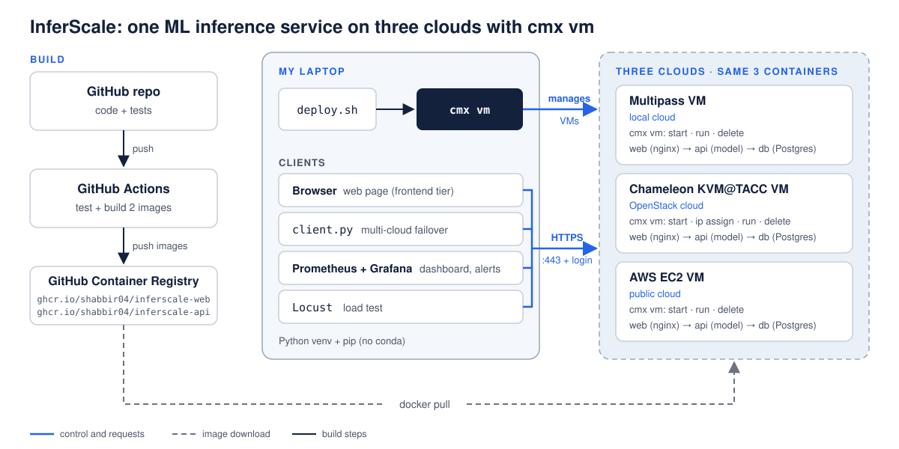
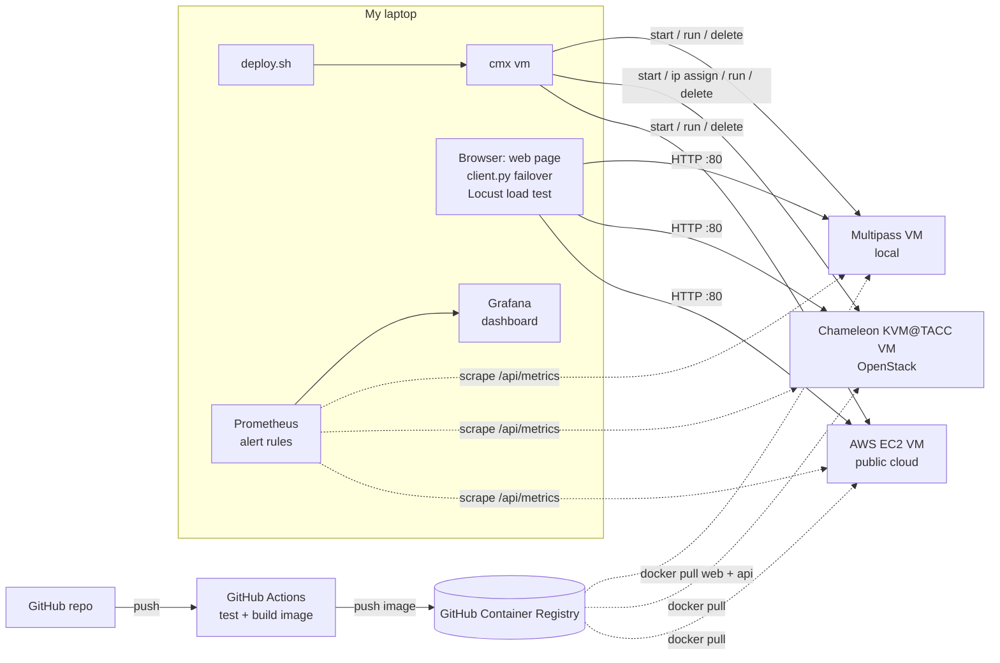
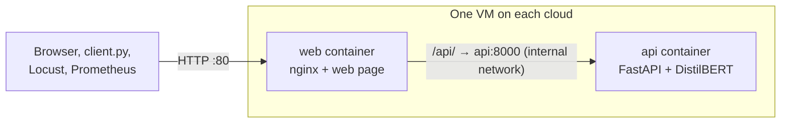

# InferScale: One ML Inference Service on Three Clouds with cmx vm

|                  |                                                                  |
| ---------------- | ---------------------------------------------------------------- |
| **Course:**      | COMP 488 – Cloud Computing, DevOps, and AI                       |
| **Team Members** | - *Khaja Shabbir Ahmed* – Cloud / DevOps Engineer (solo project) |
| **Contact**      | <kahmed5@luc.edu>                                                |
| **Instructor**   | Gregor von Laszewski                                             |
| **Repository**   | https://github.com/cloudmesh-ai-luc/shabbir04                    |
| **Date**         | *Sep. 22, 2026*                                                  |

---

## 1. Executive Summary

**Problem.** The same AI service often has to run on more than one cloud, but every cloud has its own
way to create VMs, give them a public IP and clean them up. That makes deployments hard to repeat and
clouds hard to compare fairly.

**What InferScale does.** InferScale is a small two-tier machine-learning service: a web frontend (nginx and
a small HTML/JavaScript page) in front of a backend that serves a sentiment-analysis model (DistilBERT)
through a FastAPI REST API. Each tier is its own Docker container, and the same two containers run on three
clouds: **Multipass** on my laptop (local), **Chameleon KVM@TACC** (OpenStack) and **AWS EC2** (public
cloud). All VMs are created, reached and deleted with one tool, **`cmx vm`** from the class project
[cloudmesh-ai-vm](https://github.com/cloudmesh-ai/cloudmesh-ai-vm), which I also contribute to. One
deploy script runs the same steps on every cloud, and a load test measures how each cloud performs.
On top of plain predictions, InferScale has three features: an **AI review filter**, **live monitoring
with alerts** of all three clouds (Prometheus and Grafana), and **multi-cloud failover**.

**Result.** A repeatable, automated workflow and a side-by-side comparison of deployment time, response
time and cost on the three clouds. Where `cmx vm` falls short for this workflow, I fix it in small pull
requests (for example the `cmx vm ip` command).

---

## 2. Cloud Computing, DevOps, and AI

| Area | How InferScale addresses it |
| ---- | --------------------------- |
| **Cloud Computing** | Runs the same service as VMs (IaaS) on three different kinds of cloud: a local hypervisor, an OpenStack research cloud and a public cloud. Each VM runs a two-tier application: a public web frontend in front of a private model backend. Uses each cloud's networking (local IP, floating IP, public IP), security groups, Chameleon leases, and compares cost. `cmx vm` hides the differences behind one command line. **Feature: multi-cloud failover.** When one cloud is down, requests go to the next cloud. |
| **DevOps** | GitHub flow (branches, pull requests, issues), automated tests and Docker builds with GitHub Actions, a container registry, one deploy script for all clouds, a smoke test after every deployment, and clean-up so nothing keeps running. **Feature: live monitoring with alerts.** Every VM reports its requests, errors and response time at `/metrics`. Prometheus collects them from all three clouds, Grafana shows them on one dashboard, and an alert fires when a cloud stops answering or has too many errors. |
| **AI** | The workload is an AI model: DistilBERT sentiment analysis served for inference on CPU. The project measures how fast that model answers on each cloud. **Feature: review filter.** The model returns only the reviews with a chosen label (for example, negative) that it is confident about. |

---

## 3. Objectives & Success Criteria

| # | Objective | Success criterion |
| - | --------- | ----------------- |
| 1 | Package the frontend and backend tiers as Docker images | `/health` and `/predict` pass the tests; the web page shows a prediction; CI builds both images |
| 2 | Run the service on three clouds using `cmx vm` for all VM management | `/predict` answers on Multipass, Chameleon and AWS |
| 3 | Automate the deployment | `./deploy.sh <cloud>` goes from no VM to a working service with one command |
| 4 | Measure and compare the clouds | A results table with deploy time, latency (p50/p95), success rate and cost per cloud |
| 5 | Improve `cmx vm` where the project needs it | Small, reviewed pull requests to cloudmesh-ai-vm |
| 6 | AI review filter | `/filter` returns only the reviews with the chosen label and a score at or above the threshold |
| 7 | Live monitoring with alerts | One Grafana dashboard shows requests, errors and response time for all three clouds, updated every 5 seconds; an alert fires when a cloud stops answering |
| 8 | Multi-cloud failover | With one cloud's VM deleted during a test run, requests still succeed through the other clouds |

---

## 4. Scope

| In scope | Out of scope |
| -------- | ------------ |
| Two tiers: web frontend (nginx + HTML/JavaScript) and backend (FastAPI + DistilBERT), each in its own Docker image | Training or fine-tuning models |
| Three clouds: Multipass, Chameleon KVM@TACC, AWS EC2 | Kubernetes and autoscaling (dropped to keep the project simple) |
| Deploy script built on `cmx vm` | GPUs |
| CI with GitHub Actions | High availability and 24/7 monitoring (monitoring runs only during my sessions) |
| Load test and comparison of the three clouds | Other public clouds (Azure, GCP) |
| Small fixes to `cmx vm` | A load balancer in front of the clouds (failover is done in the client) |
| Three features: review filter, live monitoring with alerts, multi-cloud failover | Sending alerts by email or chat (alerts are shown in Prometheus and Grafana) |
| | User logins and frontend frameworks such as React |

---

## 5. Technical Approach

### 5.1 Architecture





| Component | Technology | Notes |
| --------- | ---------- | ----- |
| Web frontend (`web` container) | nginx, HTML + JavaScript | Serves the web page and forwards `/api/` to the backend; the only public port (80) |
| Backend API (`api` container) | Python, FastAPI, Hugging Face Transformers | Endpoints `GET /health`, `POST /predict`, `POST /filter`, `GET /metrics`; port 8000 on the internal Docker network only |
| Monitoring and alerts | Prometheus, Grafana (Docker on my laptop) | Prometheus collects `/metrics` from all three clouds every 5 seconds and checks the alert rules; Grafana shows one dashboard |
| Failover client | `client.py` | Sends each request to AWS, then Chameleon, then Multipass, until one answers |
| Containers | Docker, GitHub Container Registry | Images `ghcr.io/shabbir04/inferscale-web` and `ghcr.io/shabbir04/inferscale-api` |
| VM management | `cmx vm` (cloudmesh-ai-vm, `dev2` branch) | The only tool used to create, reach and delete VMs |
| Deployment | `deploy.sh` | Runs the same `cmx vm` steps on each cloud |
| Load test | Locust | Runs from my laptop against each cloud |

### 5.2 Three Clouds and cmx vm

**Why these three.** Multipass is free and fast for development. Chameleon KVM@TACC is the class
OpenStack cloud (project CH-817419). AWS is the most widely used public cloud, and new accounts get
Free plan credits.

| | Local | OpenStack | Public |
| - | ----- | --------- | ------ |
| **Cloud** | Multipass on my Mac | Chameleon KVM@TACC | AWS EC2 |
| **`cmx vm` provider** | `multipass` | `chameleon` | `aws` |
| **VM size** | 1 vCPU, 2 GB (set in `~/.config/cloudmesh/clouds.yaml`) | `m1.small` (1 vCPU, 2 GB) | `t3.small` (2 vCPU, 2 GB) |
| **OS image** | Ubuntu 22.04 | CC-Ubuntu22.04 | Ubuntu 22.04 |
| **How the service is reached** | The VM's local IP | Floating IP | The instance's public IP |
| **Port 80 (frontend tier)** | Open by default | Rule added with `cmx vm security-group` | Rule in the instance's security group |
| **Special step** | None | `cmx vm start` creates a lease; end the lease after `cmx vm delete` | Delete the instance after every session |
| **Status** | `cmx vm` VM lifecycle tested | `start`, `list`, `ip assign`, `delete` tested (Oct 14) | Account and credentials not set up yet |

**The steps `deploy.sh` runs on every cloud:**

```bash
cmx vm cloud set chameleon                 # multipass | chameleon | aws
cmx vm start inferscale                    # Chameleon: also creates a lease (--duration 2h)
cmx vm list                                # shows the VM and its IP
cmx vm run inferscale "curl -fsSL https://get.docker.com | sudo sh"
cmx vm run inferscale "sudo docker network create inferscale && \
  sudo docker run -d --name api --network inferscale ghcr.io/shabbir04/inferscale-api:latest && \
  sudo docker run -d --name web --network inferscale -p 80:80 ghcr.io/shabbir04/inferscale-web:latest"
curl http://<ip>/api/health                # smoke test through the frontend tier
locust -f loadtest.py --headless -u 10 -r 2 -t 60s --host http://<ip>
cmx vm delete inferscale                   # Chameleon: then delete the lease
```

Only the `web` container publishes a port (`-p 80:80`). The `api` container has no public port; `web`
reaches it by name (`api:8000`) on the private Docker network `inferscale`.

On Chameleon a VM can also be started without an IP (`cmx vm start inferscale --ip no`) and get one
later with `cmx vm ip assign inferscale`.

**Multi-cloud failover.** `deploy.sh` writes each cloud's IP into a small config file. `client.py` tries
the clouds in order, so the service keeps answering when one cloud is down:

```python
import requests

CLOUDS = ["http://<aws-ip>/api", "http://<chameleon-ip>/api", "http://<multipass-ip>/api"]

def predict(text):
    for url in CLOUDS:
        try:
            return requests.post(f"{url}/predict", json={"text": text}, timeout=3).json()
        except requests.RequestException:
            continue  # this cloud is down, try the next one
    raise RuntimeError("all clouds are down")
```

The demo: run requests through `client.py`, delete the AWS VM with `cmx vm delete`, and the requests
keep working through Chameleon.

### 5.3 DevOps Pipeline

| Stage | Tool | What it does |
| ----- | ---- | ------------ |
| Source | GitHub | One branch per change, pull requests, issues |
| Test | pytest (GitHub Actions) | Tests `/health` and `/predict` on every push |
| Build | Docker (GitHub Actions) | Builds the two images (`inferscale-web`, `inferscale-api`) and pushes them to GitHub Container Registry |
| Deploy | `deploy.sh` + `cmx vm` | Creates the VM and starts both containers on the chosen cloud |
| Verify | `curl /api/health`, Locust | Checks the service through the frontend tier, then measures latency |
| Monitor | Prometheus + Grafana | Shows live requests, errors and response time for all three clouds, and raises an alert when a cloud is down or has too many errors |
| Clean up | `cmx vm delete` | Removes the VM (and the Chameleon lease) after each session |

The Python environment is a `venv` with `pip`, not conda, which keeps the VMs and containers clean.

**Live monitoring with alerts.** Prometheus and Grafana run in Docker on my laptop (`docker compose up`).
`deploy.sh` writes each cloud's IP into `targets.json`, and Prometheus reads the file again when it
changes. Prometheus collects `/api/metrics` through the frontend tier of every cloud every 5 seconds and
checks two alert rules:

```yaml
# prometheus.yml
scrape_configs:
  - job_name: inferscale
    scrape_interval: 5s
    metrics_path: /api/metrics   # nginx forwards it to the backend
    file_sd_configs:
      - files: [targets.json]    # one entry per cloud, e.g. {"targets": ["<aws-ip>:80"], "labels": {"cloud": "aws"}}
rule_files: [alerts.yml]
```

```yaml
# alerts.yml
groups:
  - name: inferscale
    rules:
      - alert: CloudDown          # a cloud does not answer for 1 minute
        expr: up{job="inferscale"} == 0
        for: 1m
      - alert: HighErrorRate      # more than 5 % of requests fail for 1 minute
        expr: sum by (cloud) (rate(http_requests_total{status="5xx"}[1m]))
              / sum by (cloud) (rate(http_requests_total[1m])) > 0.05
        for: 1m
```

The Grafana dashboard has one line per cloud for requests per second, errors and p95 response time, and
a panel that lists the alerts that are firing.

### 5.4 Frontend Tier

InferScale has two tiers. Each runs in its own container on the same VM:

| | Frontend tier | Backend tier |
| - | ------------- | ------------ |
| **Container** | `web`: nginx + one HTML/JavaScript page | `api`: FastAPI + DistilBERT |
| **Image** | `ghcr.io/shabbir04/inferscale-web` | `ghcr.io/shabbir04/inferscale-api` |
| **Job** | Shows the web page and forwards every `/api/...` request to the backend | Runs the model and answers `/health`, `/predict`, `/filter`, `/metrics` |
| **Port** | 80, the only public port | 8000, only on the internal Docker network |



The page has two parts: type one review and press **Analyze** to see its label and score, or paste
several reviews and press **Filter** to see only the confident ones with the chosen label. nginx serves
the page and passes API calls to the backend:

```nginx
# nginx.conf in the web image
server {
    listen 80;
    location /     { root /usr/share/nginx/html; }   # the web page
    location /api/ { proxy_pass http://api:8000/; }  # forward to the backend tier
}
```

The page calls the backend only through nginx, so the browser never talks to the model container directly:

```javascript
async function analyze() {
  const text = document.getElementById("text").value;
  const r = await fetch("/api/predict", {method: "POST", headers: {"Content-Type": "application/json"},
                                         body: JSON.stringify({text})});
  const {label, score} = await r.json();
  document.getElementById("result").textContent = `${label} (${score.toFixed(2)})`;
}
```

The page and the API come from the same address, so no CORS setup is needed.

### 5.5 AI / Model Serving (Backend Tier)

The model is `distilbert/distilbert-base-uncased-finetuned-sst-2-english`. It is small enough to run on a
CPU and fit in a 2 GB VM. The core of the service:

```python
from fastapi import FastAPI
from prometheus_fastapi_instrumentator import Instrumentator
from transformers import pipeline

app = FastAPI()
Instrumentator().instrument(app).expose(app)   # adds GET /metrics
classifier = pipeline("sentiment-analysis",
                      model="distilbert/distilbert-base-uncased-finetuned-sst-2-english")

@app.get("/health")
def health():
    return {"status": "ok"}

@app.post("/predict")
def predict(item: dict):
    return classifier(item["text"])[0]   # e.g. {"label": "POSITIVE", "score": 0.99}

@app.post("/filter")
def filter_reviews(item: dict):
    # e.g. {"texts": [...], "label": "NEGATIVE", "min_score": 0.9} -> only the confident negative reviews
    label = item.get("label", "NEGATIVE")
    min_score = item.get("min_score", 0.9)
    results = classifier(item["texts"])
    return [{"text": t, **r} for t, r in zip(item["texts"], results)
            if r["label"] == label and r["score"] >= min_score]
```

`/metrics` comes from the `prometheus-fastapi-instrumentator` library. It counts every request with its
status code and response time, in the format Prometheus reads.

### 5.6 Security

- Login to VMs only with SSH keys, no passwords.
- Cloud credentials stay in `~/.config/` and are never committed to Git.
- Only port 80 (the frontend tier) is open, and only during testing. The backend has no public port: it is
  reached only through nginx on the internal Docker network. Every VM is deleted after each session.
- Prometheus and Grafana run only on my laptop, so their web pages are not open to the internet.
- The test data is public example text, with no personal data.

---

## 6. Project Plan & Timeline

| Phase | Tasks | When | Status |
| ----- | ----- | ---- | ------ |
| Topic | Title, first summary | Sep 23 – Oct 1 | Done |
| `cmx vm` on two clouds | VM lifecycle on Multipass and Chameleon, including the `cmx vm ip` command | Sep 29 – Oct 14 | Done |
| Simpler design | Three clouds + `cmx vm` instead of Kubernetes | Oct 14 | Done |
| Third cloud | AWS account and credentials, first `cmx vm` VM on AWS | Oct 15 – Oct 22 | Next |
| Service | Backend (FastAPI + model, `/filter`, `/metrics`), frontend (web page + nginx), Dockerfiles, tests | Oct 15 – Oct 29 | Next |
| CI | GitHub Actions: test, build, push image | Oct 29 – Nov 5 | Planned |
| Deploy script | `deploy.sh` for all three clouds | Nov 5 – Nov 12 | Planned |
| Monitoring + failover | Prometheus + Grafana (dashboard, alert rules), `client.py` | Nov 12 – Nov 19 | Planned |
| Measurements | Load tests and the failover test on the three clouds, results table | Nov 19 – Dec 3 | Planned |
| Final | Report and presentation | Dec 3 – Dec 10 | Planned |

---

## 7. Resources & Budget

| Resource | Use | Cost |
| -------- | --- | ---- |
| Multipass on my Mac | Development and the local cloud | $0 |
| Chameleon KVM@TACC, `m1.small` | 1–2 hour leases per session (project CH-817419) | Class allocation, no money |
| AWS EC2 `t3.small` | Short sessions, deleted afterwards | About $0.02 per hour, covered by AWS Free plan credits |
| GitHub Actions and Container Registry | CI and image storage | $0 within the free limits |
| Prometheus and Grafana (Docker on my Mac) | Monitoring and alerts | $0 (open source) |
| **Total** | | **$0 out of pocket** |

---

## 8. Risk Management

| Risk | Likelihood | Impact | Mitigation |
| ---- | ---------- | ------ | ---------- |
| Chameleon has no free capacity ("No valid host was found") | Medium | Delay | Retry at another time; keep sessions short |
| A Chameleon lease keeps running after `cmx vm delete` | High | Uses allocation | End the lease after every session |
| An AWS instance is left running | Low | Cost | Delete after every session; set a billing alert |
| The model needs more memory than the VM has | Medium | Service crashes | Use 2 GB VMs; add swap or use a smaller model |
| Credentials leak | Low | High | Keep them only in `~/.config/`, never in Git |
| The failover demo needs two or three clouds running at once | Medium | More cost and allocation | Keep the demo under 30 minutes and delete everything right after |

---

## 9. Evaluation & Success Metrics

| Metric | How it is measured | Target |
| ------ | ------------------ | ------ |
| Deploy time (`cmx vm start` → first good `/predict`) | Timer in `deploy.sh` | Under 15 minutes on each cloud |
| Latency p50 / p95 | Locust, 60 s, 10 users | Reported per cloud |
| Success rate | Locust | At least 99 % |
| Cost per session | Provider pricing and allocation used | Under $1 per AWS session |
| Same script on all three clouds | Run `deploy.sh` with each cloud | Works without changes to the steps |
| Review filter accuracy | `/filter` on 20 reviews I label by hand | At least 18 of 20 correct |
| Live monitoring | Grafana dashboard during a load test | All three clouds shown, updated every 5 seconds |
| Alerts | Delete one cloud's VM during the failover test | The `CloudDown` alert fires within 2 minutes |
| Failover | 200 requests through `client.py`, AWS VM deleted halfway | At least 99 % succeed |

---

## 10. Deliverables

| Deliverable | Format |
| ----------- | ------ |
| Backend (FastAPI + model) and frontend (web page + nginx), their Dockerfiles and tests | Code in this repository |
| GitHub Actions workflow | `.github/workflows/` |
| `deploy.sh` built on `cmx vm` | Script in this repository |
| Review filter (`/filter`) and `/metrics` | Part of the inference service |
| Prometheus and Grafana setup (`docker-compose.yml`, `prometheus.yml`, `alerts.yml`, dashboard) | Files in this repository, plus dashboard screenshots |
| `client.py` (multi-cloud failover) | Script in this repository |
| Results table and chart for the three clouds | Markdown in this repository |
| Contributions to `cmx vm` | Pull requests to cloudmesh-ai-vm |
| Presentation | In class |

---

## 11. Issues

- **AWS is not set up yet.** I still need the account and credentials, and I have not tested whether the
  `aws` provider in `cmx vm` supports everything the deploy script needs (public IP, security group rule).
  If not, I open the port in the AWS console and report the gap.
- **Which Chameleon code to use.** `cmx vm` has two versions for Chameleon: the `dev2` branch and the
  `feature/chameleon-native-chi` branch. I need to know which one the project should build on.
- **Chameleon clean-up gaps.** `cmx vm delete` does not end the lease, and releasing a floating IP fails
  because python-chi uses a compute call that KVM@TACC no longer supports, so IPs stay reserved.
- **Is 2 GB enough** for DistilBERT plus Docker? If not, I add swap or use a smaller model.
- **The VMs are not identical** (`t3.small` has 2 vCPUs, `m1.small` has 1), so the results note the
  differences instead of treating them as a perfectly fair comparison.
- **Failover is done in the client.** It is the simplest way. A load balancer in front of the clouds would
  be more realistic, but it needs another VM. The cloud IPs also change with every deployment, so
  `deploy.sh` has to update the client's config file and Prometheus's `targets.json` each time.

---

## 12. References

- cloudmesh-ai-vm (`cmx vm`): https://github.com/cloudmesh-ai/cloudmesh-ai-vm
- Multipass: https://canonical.com/multipass
- Chameleon Cloud documentation: https://chameleoncloud.readthedocs.io
- Amazon EC2 documentation: https://docs.aws.amazon.com/ec2/
- AWS Free Tier: https://aws.amazon.com/free/
- FastAPI: https://fastapi.tiangolo.com
- nginx: https://nginx.org/en/docs/
- DistilBERT SST-2 model: https://huggingface.co/distilbert/distilbert-base-uncased-finetuned-sst-2-english
- Locust: https://locust.io
- Prometheus: https://prometheus.io/docs/
- Grafana: https://grafana.com/docs/grafana/latest/
- prometheus-fastapi-instrumentator: https://github.com/trallnag/prometheus-fastapi-instrumentator
